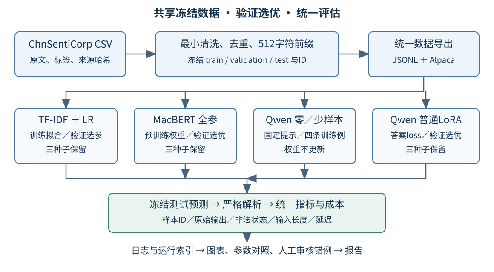
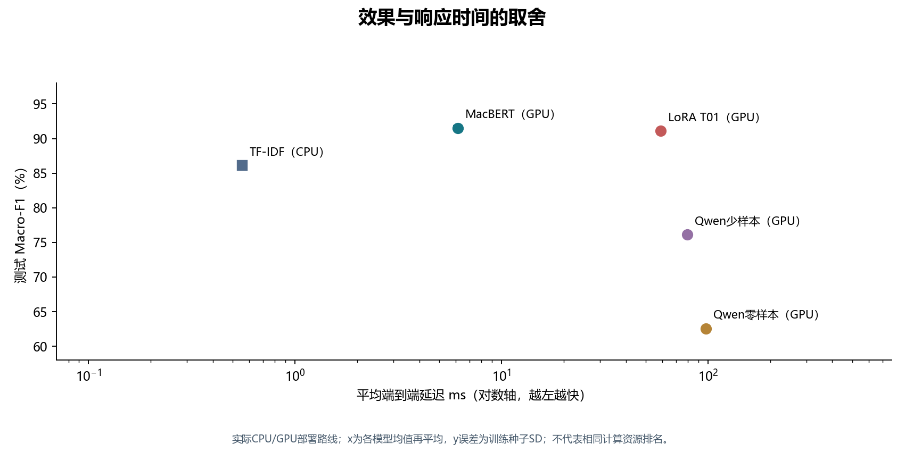
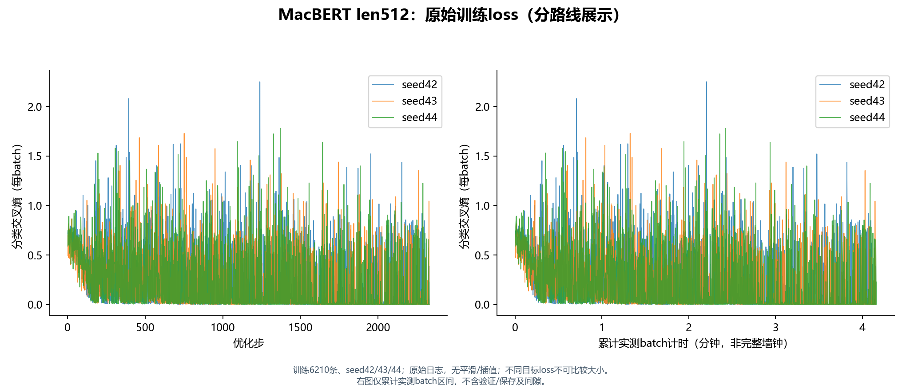
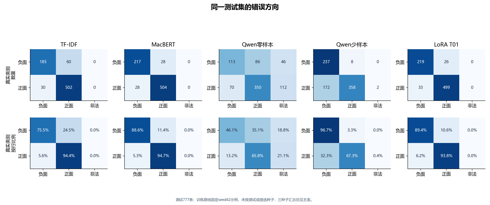

# 中文酒店评论情感分析：传统基线、提示学习与模型微调的效果及成本比较

**课程**：自然语言处理（2026—2027 秋季学期）　**组长学号／姓名**：【待补】　**方向**：C——提示与微调对比

**成员与分工**：【待补三人姓名、学号及实际负责模块，见第⑧节】

**提交日期**：【待补正式提交日期】　**仓库地址**：[liuguanghui520/NLP](https://github.com/liuguanghui520/NLP/tree/codex/integration)　**演示录屏**：【待补链接或文件名】

> 初稿日期：2026-10-29。按提供的报告模板组织，实验结果和案例解释来自已确认材料；【待补】项集中列于[缺失信息清单](缺失信息清单.md)。本稿尚未完成本人最终审核和PDF排版，正文页数需导出后核定为8—12页。贡献声明分别填写，不代签、不推定实际工时。

---

## 摘要

针对中文酒店评论情感二分类，比较TF-IDF逻辑回归、MacBERT全参微调、Qwen3-1.7B零样本、四样本提示和普通LoRA。清洗后7763条数据按6210/776/777冻结划分，验证Macro-F1选优。五方案测试Macro-F1依次为86.10%、91.52%、62.56%、76.10%、91.12%。MacBERT与LoRA平均GPU延迟分别为6.13ms、59.06ms；LoRA增量权重12.87MB。九例揭示混合评价、多对象、多说话者及格式问题。MacBERT兼顾效果和效率，LoRA改善Qwen任务表现，传统基线适合轻量部署。

## ① 问题定义与背景

酒店评论同时包含卫生、位置、服务、价格等多个方面，既可能明确表达满意或不满，也可能夹杂比较、转折和酒店回复。本项目将评论整体情感划分为负面0或正面1，面向需要批量整理住客反馈、辅助发现差评的使用场景。当前成果是课程实验与可复现工程入口，尚未部署为实际业务服务。

研究问题是：在相同冻结数据上，传统稀疏特征、预训练编码器、生成式提示和参数高效微调分别取得怎样的分类效果？增加示例或监督训练是否改善Qwen表现？效果提升对应多少训练时间、推理延迟和资源占用？

成功判据采用可检查的工程及实验条件：五条路线均完成同一测试集的完整预测；按验证Macro-F1选参；至少完成一组参数比较与三类错误归因；保存配置、日志、逐样本输出和可独立重算的指标；同时报告延迟与资源。分类效果通过基线间差值评价，没有事后补设一个“达到某分即成功”的门槛。新机按README复现主结果是独立交付条件，目前仍待验收。

## ② 相关工作与方案选型

### 2.1 备选方案与取舍

| 备选方案 | 优点 | 局限与成本 | 是否采用 | 选择理由 |
|---|---|---|---|---|
| 字符n-gram＋TF-IDF＋逻辑回归 | CPU可运行，训练快，流程明确 | 对长距离关系、对象归属和复杂转折的表示有限 | 是 | 建立低成本监督分类基线 |
| 预训练MacBERT全参数微调 | 中文上下文表示，分类头直接输出标签 | 需要标注数据与训练，可训练参数较多 | 是 | 建立预训练编码器强基线 |
| Qwen3-1.7B零样本提示 | 无任务训练步骤，可直接给出任务说明 | 分类与格式遵循均需实测，仍有推理成本 | 是 | 测量原始模型的直接任务适应能力 |
| 同基座固定4-shot | 不更新权重，示例可展示类别与格式 | 提示更长，少量示例覆盖有限 | 是 | 比较示例引导带来的收益 |
| 同基座普通LoRA | 冻结基座，训练少量增量参数 | 需要监督训练，部署仍依赖基座 | 是 | 比较训练适配与提示适配 |
| Qwen全参数微调 | 可以更新全部模型权重 | 优化器、梯度等训练状态对本机资源压力更大 | 否 | 本项目优先在8GB显存下完成普通LoRA路线 |
| RAG | 适合补充外部知识和提供检索依据 | 新增索引、检索与上下文成本 | 否 | 当前标签主要依据评论本身，未设外部知识问答目标 |

项目实际采用了微调：MacBERT进行全参数更新，Qwen进行LoRA更新。没有采用Qwen全参训练，是基于本机资源与项目范围的选择，未将“未做”表述为经过OOM实验认定不可行。未采用RAG，是因为整体情感判断的主要证据已在评论中；本项目没有需要查询的外部事实库，先完成分类路线比较更贴合研究问题。

### 2.2 为什么选择这些模型和工具

TF-IDF字符特征减少中文分词词典依赖，n-gram保留局部搭配，逻辑回归提供简单稳定的分类参照[1]。MacBERT由哈尔滨工业大学与讯飞研究院联合实验室HFL提出，面向通用中文NLP，采用纠错式掩码等预训练设计；原研究包含ChnSentiCorp分类评测，因此具有任务相关的研究基础[2]。本项目加载预训练权重后全参训练，当前路线不再使用早期的随机初始化设想。

选择Qwen3的实践起点是B站LoRA教程的推荐，【待补教程标题、作者和链接】。这一系列支持中文等多种语言、提供多种参数规模和开放权重，并支持Transformers加载，便于本地实验。Qwen3还支持思考与非思考模式切换，本任务只需输出标签，因此关闭思考，控制额外生成[3]。结合RTX 4070 Laptop的8GB显存条件采用1.7B版本；实际运行已验证当前提示和普通LoRA配置可行。

LoRA通过冻结基座、训练低秩更新矩阵来减少可训练参数及对应训练状态[4]。采用普通LoRA使对照集中于秩、注入模块、学习率等设置，未引入量化变量。LLaMA-Factory的WebUI便于首次以可视化方式理解和配置微调流程，是本人选择该工具的重要原因[5]。后续保留实际配置与日志，使用PEFT、Transformers和PyTorch执行模型相关工作，SwanLab跟踪LoRA实验；统一评估使用项目脚本。BERT与TF-IDF搜索实际为脚本枚举，未将工具安装验证写成Optuna正式搜索。

### 2.3 与课程原理的联系

第一，字符n-gram与上下文表示具有不同能力：前者提供局部统计特征，后者根据上下文构造表示，案例2和5可用于讨论混合评价与对象关联。第二，预训练目标不同：MacBERT使用掩码语言模型方向的预训练，Qwen使用自回归生成路径；项目分别通过分类头和标签生成完成任务，比较的是完整方案。第三，提示与SFT/LoRA的适应方式不同：少样本改变推理上下文，LoRA利用训练标签更新增量参数；四样本与LoRA的测试差值提供实际对照。第四，Macro-F1与Accuracy的选择体现类别不均衡时的评测取舍，见第⑤节。

## ③ 系统设计

### 3.1 总体架构与数据流



图1　数据清洗与划分仅在冻结前完成；模型训练、验证选优与最终测试分别组织。权重保留在个人工具目录，统一项目保存配置、资源关联、预测和证据。

原始CSV经最小清洗和去重，形成共享JSONL与LoRA所需Alpaca格式。训练集用于拟合特征、模型训练和少样本示例选择；验证集用于选配置和检查点；冻结后对测试集预测。各路线输出同一协议的逐样本记录，交由统一评估入口计算指标和错例，再生成图表与报告素材。

### 3.2 模块与职责

| 模块 | 主要文件或目录 | 职责 |
|---|---|---|
| 数据与版本 | `data/processed/`、`data/manifests/` | 保存冻结数据、划分ID、排除记录及哈希 |
| 路线配置 | `configs/methods/`、各运行`config.json` | 保存提示、示例、LoRA和基线参数 |
| 模型接入 | `src/adapters/`、`src/legacy/` | 接入既有基线、提示及普通生成式LoRA |
| 统一入口 | `src/cli.py` | 资源检查、导入、预测、评估、基准与汇总 |
| 指标计算 | `src/evaluation/` | 校验ID、真值、解析和预测完整性，统一计算指标 |
| 分析与展示 | `src/analysis/`、`scripts/` | 生成参数、成本、配对统计及错误分析材料 |
| 追溯与成果 | `results/`、`reports/`、`logs/` | 保存运行索引、日志、预测、指标、图表和审计 |

预测记录包含样本ID、真值、原始输出、解析标签、状态、输入字符和token长度、截断标记及耗时。新运行使用唯一ID和全新目录；失败、重试和历史结果分别保留。

## ④ 实现细节

### 4.1 数据处理与冻结

使用ModelScope `AiNiklaus/ChnSentiCorp`中的酒店评论CSV，共7766条。只统一换行符、去首尾空白，保留否定词、标点及原始文本；先核查全文重复，再生成前512个Unicode字符的共享正文。排除1条空文本和2条重复截断前缀，得到7763条有效记录，最终203条需要字符截断。前缀碰撞按本人确认保留源序号最小记录。

| 划分 | 数量 | 负面0 | 正面1 |
|---|---:|---:|---:|
| 训练 | 6210 | 1954 | 4256 |
| 验证 | 776 | 244 | 532 |
| 测试 | 777 | 245 | 532 |

本项目以该CSV重新分层划分：先取20%临时集，再将其等分为验证与测试，两次种子均67。划分并非原论文的9600/1200/1200设置。冻结后ID集合互斥、精确重复前缀无跨集碰撞；未实施近似语义去重。成员来源数据的Alpaca正文哈希和ID顺序已对齐，通用JSONL序列化差异及未能逐字核对的历史部分保留在审计中。

### 4.2 最终训练与推理配置

| 路线 | 实际配置 |
|---|---|
| TF-IDF＋LR | 字符1—3 gram，`min_df=2`，最多20万特征，sublinear TF；LR的C=4，lbfgs，max_iter=2000，不加类别权重；仅在训练集拟合 |
| MacBERT | `hfl/chinese-macbert-base`预训练全参；token上限512，batch8，累积1，最多3轮；AdamW，lr2e-5，weight_decay0.01，warmup0.1，linear，裁剪1.0，FP32 |
| Qwen零／少样本 | `Qwen/Qwen3-1.7B`，总输入上限2048 token，BF16，关闭思考，贪心、单束、最多8个新token；超限仅从评论尾部截断 |
| 普通LoRA T01 | 同Qwen基座，r8、alpha16、q/k/v/o、dropout0.05；3轮，lr1e-4，AdamW，weight_decay0，warmup0.1，linear；microbatch1、累积16，BF16、梯度检查点，仅答案token计算loss |

MacBERT共有102269186个可训练参数；LoRA最终T01为3211264个可训练参数。MacBERT基座锁定revision `a986e004d2a7f2a1c2f5a3edef4e20604a974ed1`。Qwen提示注册表记录revision `4855588ea1a12789f2e965e5f52a9e4a24c94b2a`；LoRA原始下载revision未确认，统一评估实际按本地基座文件SHA256锁定，不将注册表字段当成全部历史下载证据。

零样本任务提示为：

```text
判断评论整体情感，仅输出0表示负面、1表示正面。

<评论>
{{comment}}
</评论>
```

少样本在同一聊天模板中加入训练集正负各两条，按负、正、负、正排列；固定ID尾号5542、3812、5693、4407，正文可由冻结训练集恢复。LoRA训练与推理不放示例，采用“同一任务说明＋单换行＋评论”。不同路线的格式如实保留，未在测试后改写成相同提示。配置证据见[提示注册表](../../../configs/methods/prompt_registry.json)、[LoRA冻结配置](../../../configs/methods/lora-frozen.json)及[基线配置](../../../results/evidence/formal-analysis-20261028-01/bert/bert-len512-seed42/config.json)。

### 4.3 关键问题与解决记录

| 实际问题 | 处理方式与验证 |
|---|---|
| 原基线包按Accuracy选优，缺少可核查的各轮验证产物 | 统一改为验证Macro-F1；重新执行8组BERT与4组TF-IDF搜索，保存每轮指标、配置、模型和验证预测 |
| 冒烟前32条仅含正类，逻辑回归拟合失败 | 保留原失败状态，改用两类各16条的冒烟子集重试；不计入正式成绩 |
| 首次预热ID查询划分错误 | 按全部冻结划分查找原ID，不重新抽样或改变预热ID |
| 首次TF-IDF延迟与BERT训练重叠 | 原记录留档；正式采用后续独立`test-isolated`测量 |
| 提示来源包示例正文被脱敏 | 按固定训练ID恢复，并核验示例文本及历史验证输入哈希 |
| 不同路线输出与指标不一致 | 统一严格0/1解析、非法计错、完整ID校验及独立重算；首次失败与重试关联记录 |

模型保存后重载核查预测；BERT验证了epoch边界模型、优化器、调度器和随机状态恢复。未将这一检查扩大描述为任意step精确恢复或所有路线完整续训。

### 4.4 环境

硬件为Intel Core i7-14650HX（16核24线程）、16GiB内存、RTX 4070 Laptop GPU（8188MiB显存）。模型运行于Windows宿主下WSL2 Ubuntu22.04.5，Python3.11.17、PyTorch2.14.1、Transformers5.8.0、PEFT0.18.1、scikit-learn1.9.1、LLaMA-Factory0.9.6.dev0。MacBERT使用FP32，Qwen使用BF16，模型推理在本机完成，没有按token付费的模型API调用。

环境标识E01：硬件与驱动于2026-10-29补采，训练与推理使用同一硬件和基础环境由本人确认。驱动616.92，驱动报告CUDA支持13.4，PyTorch CUDA构建13.0；独立Toolkit版本未确认。离线统计绘图为Windows Python3.13.9、NumPy2.3.5，单独记录。完整来源见[环境说明](../../environment/实验运行环境与延迟口径.md)。

## ⑤ 评估

### 5.1 数据与指标协议

最终测试777条，来源、构造和划分互斥情况见4.1。训练、参数与检查点选择使用训练／验证集；历史测试已被查看，本报告的案例及概率解释属于事后分析，后续改进另立实验版本。

指标以**整条评论**为单位，不采用token或实体级F1。令类别c的TP、FP、FN按统一预测统计，Precision=TP/(TP+FP)，Recall=TP/(TP+FN)，F1=2PR/(P+R)，Macro-F1=(F1负+F1正)/2；分母为零时记0。Accuracy为正确条数／777。非法生成也占总样本数，对真实类别形成FN；混淆矩阵保留非法列，不删除该样本。输出只去首尾空白，完整等于0或1才合法。

参数搜索统一种子42，优胜训练配置补43、44；逐运行算指标后平均，SD为分母n−1的样本标准差，不按测试挑种子。零／少样本确定性结果各一次。数据划分和统计重采样种子67不改变训练种子的含义。

### 5.2 主结果与推理成本

| 方案 | 测试Macro-F1 | Accuracy | 平均延迟ms | P95均值ms | 平均输入／输出token |
|---|---:|---:|---:|---:|---|
| 多数类参考：全预测正面 | 40.64% | 68.47% | 不计成本排名 | — | 不适用 |
| TF-IDF＋LR（CPU） | 86.10% | 88.42% | 0.555 | 0.894 | 不采用生成token计量 |
| MacBERT全参（GPU） | 91.52% | 92.62% | 6.133 | 10.668 | 无生成输出；本表不混用分词器统计 |
| Qwen零样本（GPU） | 62.56% | 59.59% | 97.706 | 251.918 | 111.23／3.22 |
| Qwen固定4-shot（GPU） | 76.10% | 76.58% | 79.414 | 100.536 | 380.23／2.02 |
| Qwen普通LoRA（GPU） | 91.12% | 92.28% | 59.056 | 70.277 | 104.84／2.00 |

表1　训练路线为三种子指标均值，提示路线为单次结果。token均值由各运行777条正式预测记录汇总，输出token沿用实际计数，可能包含终止标记；LoRA三个种子均值相同。token数用于描述计算量，不换算未发生的API账单。

延迟统一在模型已加载时，固定同200条测试评论与顺序、20条训练评论预热、batch1串行、线程配置4；包含分词、传输、推理和标签解析，不含读盘与模型加载，GPU前后同步。P95均值是各运行P95再平均，不是混合全部运行后求P95。环境E01，CPU与GPU分别标注。



图2　同一计时协议下的效果—延迟比较。MacBERT为GPU FP32，Qwen为GPU BF16，TF-IDF为CPU；训练路线按三种子汇总。坐标尺度与误差条含义按图注读取，环境E01。

MacBERT与LoRA分别达到91.52%和91.12%，传统基线86.10%仍有竞争力。四条示例使Qwen Macro-F1提高13.55个百分点，非法输出由158/777降至2/777；LoRA比少样本再提高15.01个百分点，三个种子均无非法输出。少样本需要更长输入，但零样本实际生成更多token，因此不能仅按提示长度推断端到端延迟。

### 5.3 分类别表现与稳定性

| 方案 | 负面Recall | 正面Recall | 非法率 | Macro-F1样本SD／百分点 |
|---|---:|---:|---:|---:|
| TF-IDF | 75.51% | 94.36% | 0 | 0.000 |
| MacBERT | 89.66% | 93.98% | 0 | 0.346 |
| Qwen零样本 | 46.12% | 65.79% | 20.33% | 不适用 |
| Qwen少样本 | 96.73% | 67.29% | 0.26% | 不适用 |
| Qwen LoRA | 88.98% | 93.80% | 0 | 0.149 |

少样本正确识别245条负面中的237条，却把172条正面判成负面，负面Precision只有57.95%。MacBERT和LoRA两类表现更均衡；多数类参考行也说明68.47%的Accuracy并不代表能够识别差评。

MacBERT平均Macro-F1高于LoRA约0.40个百分点。固定六个已训练模型和当前类别比例的配对分层贝叶斯bootstrap，10000次中6991次MacBERT均分更高，约70%；条件配对bootstrap差值95%区间为−1.07至1.93个百分点。证据略偏向MacBERT，两者总体接近。LoRA三次分数SD更小；三次训练的波动与测试样本统计不确定性分别报告。[概率记录](../../../reports/analysis/conclusions-confirmed-20261029-01/贝叶斯概率估计.json)

### 5.4 参数对比

以下全部是验证集776条、种子42的结果，与表1测试分数分开。LoRA先固定alpha/r=2，对照秩和注入模块：

| 配置 | 模块 | r／alpha | 可训练参数 | 验证Macro-F1 | 适配器权重MB |
|---|---|---|---:|---:|---:|
| B00 | q/v | 8／16 | 1605632 | 90.95% | 6.44 |
| R01 | q/v | 16／32 | 3211264 | 91.05% | 12.86 |
| T01 | q/k/v/o | 8／16 | 3211264 | 91.39% | 12.87 |


图3　LoRA秩与注入模块的验证对照，参数量、时间边界及单位见原图。T01与R01可训练参数相同，T01验证F1高约0.34个百分点，因此选择T01，补充种子43、44后汇总三个种子。

在q/v配置中，秩翻倍只提高约0.10个百分点；同参数量下扩大模块覆盖在本组更有效。其他验证对照包括：BERT学习率1e-5、2e-5、5e-5分别为90.47%、90.62%、90.49%；长度／batch为128/16、256/16、512/8分别为89.42%、90.62%、90.87%，最终选择512组合，但耗时比256组合增加约48%。TF-IDF字符1—3 gram为88.37%，高于词1—2 gram的87.20%。

完整十二项对照另见[参数结论](../../../reports/analysis/conclusions-confirmed-20261029-01/参数对比结论.md)。部分实验同时改变batch、学习率或总步数，按组合配置解释；未测试的512＋加权、T01＋cosine不叠加收益。

### 5.5 训练过程与结论

BERT保留逐batch loss与逐轮验证，LoRA保留每10步loss日志和逐轮验证；两者loss分别是分类loss和答案token loss，不直接比较绝对值。BERT最多5轮对照中，训练loss由0.3447继续降至0.0298，但最佳验证成绩在第1轮，说明训练loss下降不能代替泛化评价。原曲线见附录C。

结合效果和成本，本项目中MacBERT兼顾91.52%的Macro-F1、6.13ms平均延迟与约409.54MB部署体积；LoRA有效提升同Qwen基座的任务表现；TF-IDF以约0.56ms CPU延迟提供轻量选择。此结论对应当前数据、硬件和完整配置。

## ⑥ 错误分析与局限

### 6.1 五类失败及改进方向

从11个测试运行取错误并集，得到402条去重评论、1118个错误“样本—运行”组合。本人试标20条，其余382条由AI按确认规则辅助标注；本节九例解释及正文编排经本人逐项审核。九例用于展示错误形态，不据此估算各类错误的总体比例。

| 类别／案例ID尾号 | 失败样例：输入线索→实际输出 | 归因与局限 | 可能的改进 |
|---|---|---|---|
| 任务适应性／5546 | “很差，相当差”，真值负面→仅零样本合法输出1；其余路线正确 | 当前提示下，原始模型仍会误判明确情感；38字符，无记录到的截断 | 代表性示例或监督适配；本例已被少样本和LoRA修正 |
| 混合评价／6353、4086 | 卫生差但肯定前台，负面→TF-IDF三种子判正；弱肯定夹杂缺点，正面→零／少样本判负 | 整体与局部评价取舍会在两个方向失败；6353零样本另属格式错误 | 核查特征贡献，以正负两方向混合评价验证分句或方面特征 |
| 多评价对象／6865、6957 | 当前酒店差、另一酒店更好，负面→6957仅TF-IDF三种子判正；6865多个监督模型仍判正 | 不同酒店、平台和方面的情感归属可能混淆 | 明确目标对象并验证边界标记，同时检查单对象样本退化 |
| 多说话者／6197 | 住客批评后附酒店回复，负面→TF-IDF、MacBERT、LoRA三种子及少样本共10次判正 | 回复与住客立场不同；也可能受开头肯定影响 | 对照原文、角色标记、仅住客正文，核查实际收益 |
| 格式遵循／5773 | 扣房费、不满意，负面→零样本输出“根据评论内容，整体情感偏向负面。” | 语义表达负面但不满足数字协议，正式计非法；其余运行正确 | 验证限定0/1完整序列的解码约束，联合检查分类、非法率和延迟 |

多对象主例6865中，MacBERT42/44、TF-IDF及LoRA三个种子均判正，MacBERT43和少样本判负；零样本输出1后解释，正式为非法。该例说明微调后仍存在复杂比较错误。固定少样本在4086也未修正弱正面误判，因此案例5546的改善不外推为“少样本或微调消除所有错误”。

### 6.2 数据、稳定性及覆盖局限

案例647源标签正面而本人初判负面，涉及陈旧设施、卫生间、服务和早餐的不同取舍，尚无最终裁定；正式分数保留源标签。案例7015为明确负面，只有MacBERT种子44判正，其他运行均正确，说明逐样本结果可能随训练运行变化。

当前124条仍待复核，包括73条标签分歧、45条不确定、6条输入可见性问题。全部402条不能表述为独立人工金标；对象或说话者混淆是证据支持的解释线索，尚未通过输入干预验证机制。改进建议利用了测试反馈，未来需单独编号评估，不覆盖冻结结果。

数据集中于酒店领域，不能直接推定电商、社交文本等领域表现。512字符前缀及模型token预算可能丢失尾部线索，测试字符截断子群仅20条，不据此作强因果排名。搜索主要为单种子、有限候选，未覆盖所有参数组合。不同基座、结构、精度、提示和监督量意味着本项目比较完整方案，不能把全部差异归因于某个训练机制。九例全文及逐运行输出见[确认版案例](../../../reports/analysis/case-confirmed-20261029-01/正文案例与局限定稿.md)。

## ⑦ 工程与伦理

### 7.1 成本、延迟和资源

| 路线 | 搜索＋补种子次数 | 已记录成功运行累计时间 | 完整部署大小 | 推理allocated／reserved峰值MiB |
|---|---|---|---|---|
| TF-IDF | 4＋2 | 1.73分钟 | 5.96MB | 不适用 |
| MacBERT | 8＋2 | 37.85分钟 | 409.54MB | 416.88／470 |
| Qwen零样本 | 无任务训练 | 不适用 | 4.08GB | 3365.10／3404 |
| Qwen少样本 | 无任务训练 | 不适用 | 4.08GB | 3409.08／3504 |
| Qwen普通LoRA | 10＋2 | 约10小时21分钟 | 4.09GB | 3372.59／5202 |


图4　显存为加载后测试、预热、计时全过程记录峰值，不能用作训练峰值。完整部署与新增适配器使用不同面板。E01环境；MB/GB为十进制，MiB为二进制。

LoRA适配器权重12.87464MB，含配置增量12.875648MB，完整部署仍需约4079.45MB基座。allocated与reserved不相加，结束RSS不冒充峰值RSS。训练总投入按成功运行身份去重，搜索已包含种子42；LoRA T01单次Trainer约59—60分钟，不将全部搜索时间当作单模型耗时。各路线历史计时边界不同，失败、准备工时和部分设备采样缺失，因此已记录值为成本下界。

所有分类模型在本机推理，token计数见表1，无模型API单价。未采集完整能耗、电价及训练全过程设备状态，不能估算人民币成本或把本地成本写为零。

### 7.2 数据许可、隐私与使用范围

数据源、文件哈希与许可核查状态均保留于数据清单。源仓库模板README出现Apache2.0标记，但独立许可文件及具体评论再分发范围尚未核验完成，【待补最终许可结论和依据】。模型许可证见官方模型页，数据许可与模型许可分别说明。

项目已按本人2026-10-28的授权统一公开既有数据、预测和日志；发布决定不能替代来源许可核查。当前没有完成评论个人信息的专项脱敏验收，【待补负责人、检查范围及实际处理结果】。SwanLab采用云端记录模式，【待补实际上传字段及是否涉及评论正文的核查】。凭据、账户密钥和个人资源配置不作为提交材料；不以“公开数据”推定不存在隐私问题。

### 7.3 AI使用声明

项目使用Codex等AI辅助查阅文档、整理参数候选和方案、编写及调试工程代码、对齐接口、核对指标和日志、整理图表、辅助标注及文字表达。本报告初稿由AI依据现有记录及本人已审核结论组织，新增的技术选型文字仍待本人最终审核；精确AI模型版本未核实时不补填。

本人在对话中选择和确认实验方案，试标20条，逐例审核九个案例解释，逐项确认八项模型结论与十二项参数结论，修订任务适应性解释，并补充教程和WebUI选型原因。382条错例为AI辅助，124条待复核，来源如实保留。验证依据包括原始逐样本预测、统一指标重算、配置和SHA256、原始日志及图表审查；软件测试不作为模型质量证据。

【待补：三名成员各自实际使用的AI工具、人工修改和独立核查说明。】最终提交时应由成员逐项核对本稿，用自己能够解释的文字形成最终报告，并按课程要求如实声明AI参与范围，不将草稿称为全部人工独立撰写。

## ⑧ 分工与贡献

以下只填写当前能确认的范围，其他内容由成员本人补充。工作量占比不按早期计划或AI推定填写；若最终模板要求百分比，三人确认后填写并与各自声明一致。

| 学号 | 姓名 | 负责模块 | 产出证据（文件／提交／实验） | 工作量占比 |
|---|---|---|---|---|
| 【待补】 | 【本人姓名待补】 | LoRA相关工作；案例和结论审核；其余实际职责待确认 | T01配置与训练记录；九案例确认稿；模型和参数结论确认稿；成员需补本人实际代码与提交对应 | 【本人确认后填】 |
| 【待补】 | 【成员二待补】 | 【待补实际职责】 | 【待补实际文件、实验、提交】 | 【本人确认后填】 |
| 【待补】 | 【成员三待补】 | 【待补实际职责】 | 【待补实际文件、实验、提交】 | 【本人确认后填】 |

工程集成提交只能证明版本推进，不自动证明某名成员独立完成全部内容。三份个人贡献声明初稿分别见[成员一](贡献声明_成员一_初稿.md)、[成员二](贡献声明_成员二_待填写.md)、[成员三](贡献声明_成员三_待填写.md)，签名、工时和队友确认由本人填写。

---

## 附录

### A. 复现指南

**A1　现有记录的离线分析复现。** 在仓库根目录、准备兼容依赖后，使用全新输出ID执行：

```powershell
python scripts/build_comparison_report.py --config configs/analysis/comparison-formal-v1.json --run-id report-review-new-001
```

预期在`results/analysis/report-review-new-001/`、`reports/analysis/report-review-new-001/`及对应图表目录生成汇总、22组图和状态记录，核对测试集777条、11个运行及表1效果值。该命令基于已有预测，不加载模型，不等于真实模型新机复现。目录已存在时换全新ID；离线Windows环境尚待单独锁定和新机验证。

**A2　真实模型预测入口。** 按根README获取权重与适配器，将`configs/paths.example.json`复制为`configs/paths.local.json`并填写自己的数据、模型和工具地址，然后在模型环境执行示例命令：

```text
python -m src.cli predict --method qwen_lora --seed 42 --split test --output results/local/new-machine-lora42-001
```

预期输出777条`predictions.jsonl`、`metrics.json`、`config.json`、`status.json`，以及固定200条延迟记录等。该示例只验证一个模型／种子，不能替代全部主结果。资源外链尚未验收，新机真实执行尚未完成，【待补实际命令、环境、日期和日志】。不得仅凭离线重算声称“新机跑通”。

### B. 代码结构说明

```text
NLP/
├── README.md                 # 安装、路径与统一命令
├── configs/                  # 数据、方法、评估和分析配置
├── data/processed/           # 冻结JSONL、Alpaca及索引
├── data/manifests/           # 来源、划分、子集与哈希
├── src/cli.py                # 统一工程入口
├── src/adapters/             # 导入、提示恢复及模型推理
├── src/evaluation/           # 严格解析、指标与完整性检查
├── src/legacy/               # 三方既有训练与接入代码
├── scripts/                  # 分析、审计与图表生成
├── tests/                    # 软件集成检查
├── results/                  # 预测、指标、运行索引和日志证据
├── reports/                  # 审计、图表及确认版分析
└── docs/                     # 人员文档、交接与报告草稿
```

训练框架、权重和大检查点保留在各人的工具工作区，由本地路径配置关联。协作仓库不要求成员使用作者的绝对地址。

### C. 运行日志、曲线与迭代记录

原日志示例：`bert-len512-seed42`逐轮训练loss为0.344469、0.215189、0.115225，验证Macro-F1为0.885968、0.908144、0.908733，选择第3轮。LoRA T01第10步日志loss为5.128039、lr为7.6923e-6、已用31秒；这些是原记录的节选，两条路线loss定义不同。



图A1　BERT真实逐batch loss及累计batch实测时间，不平滑；时间轴不包含全部保存等区间，不写成完整墙钟耗时。


图A2　LoRA真实每10步loss记录及Trainer耗时，三个种子分别保留，不与BERT loss绝对值比较。



图A3　显示原始计数、行比例及非法输出列；图内代表运行不能当作三种子平均矩阵，主表仍按各种子指标平均。完整图表见[正式图表总览](../../../reports/analysis/comparison-formal-20261028-03/图表总览.html)。

| 日期 | 推进内容 | 可核查证据 |
|---|---|---|
| 2026-10-23 | 数据清洗、前缀碰撞确认、分层划分与冻结 | `data/manifests/manifest.json`、`reports/data/v1-20261023/validation_report.md` |
| 2026-10-26 | LoRA十组搜索、T01补种子与失败批次保留 | `results/qwen17-comparisons/`及`configs/methods/lora-frozen.json` |
| 2026-10-28 | 基线重跑、融合、统一预测与评估 | `results/bert-tfidf-20261028-140359/执行记录.md`、`docs/integration/执行验收记录.md`；提交340c5dd、6ff484a |
| 2026-10-28 | 正式对比、382条AI辅助归因与图表审计 | `comparison-formal-20261028-03`；提交c1bab6f |
| 2026-10-29 | 九例与模型参数解释确认、环境补采、适配器图 | `case-confirmed-20261029-01`、`conclusions-confirmed-20261029-01`；提交2ef5457 |
| 2026-10-29 | 汇总证据并形成模板报告初稿 | 本目录及`docs/报告素材/`；当前工作区文件，尚未提交 |

最后一行不预填未来提交号。Git历史用于证明阶段推进，训练原发生时间仍以各运行记录为准。当前有日志和曲线，尚未找到可确认的WebUI／终端／SwanLab操作截图；若补截图，应标注真实截图日期，不补造历史运行现场。

### D. 数据来源与许可说明

来源：[ModelScope AiNiklaus/ChnSentiCorp](https://modelscope.cn/datasets/AiNiklaus/ChnSentiCorp)。源文件`ChnSentiCorp_htl_all.csv`，大小2904858字节，SHA256为`1d414b9c65caf3a836abdb4efded621968502ad3338e1a9d885ae131c86083f0`。预检核对内容revision为`eec2cd0294bbd8711cbbbaab13ec4c2320d7f815`，原下载revision未知；标签与上游CSV核对依据存于数据清单。

项目训练／验证／测试JSONL哈希分别为`a37fa5d7139c68fa2fc39bbcff0a9ae3d2beb3e7268fbd25a646b4aa65a3e22f`、`eae1c55c43f7121c4e24b4fb4634e0ea3406cbd99fe9cd05ca9151c253c7fe64`、`3df19229abb59d1868a7735b98f42fd799883c22ec37aa8a1760cc2266fb1996`。再分发许可最终依据仍待补，保持清单`redistribution_verified=false`的事实。

### 参考资料与内部证据

1. [scikit-learn：Text feature extraction](https://scikit-learn.org/stable/modules/feature_extraction.html#text-feature-extraction)。
2. Cui等，2020，[Revisiting Pre-trained Models for Chinese Natural Language Processing](https://aclanthology.org/2020.findings-emnlp.58/)；[HFL模型页](https://huggingface.co/hfl/chinese-macbert-base)。
3. [Qwen3官方介绍](https://qwenlm.github.io/blog/qwen3/)；[Qwen3-1.7B模型页](https://huggingface.co/Qwen/Qwen3-1.7B)。
4. Hu等，2021，[LoRA: Low-Rank Adaptation of Large Language Models](https://arxiv.org/abs/2106.09685)。
5. [LLaMA-Factory官方项目](https://github.com/hiyouga/LLaMA-Factory)。
6. 【待补B站教程完整出处】。
7. [九案例至技术选型证据汇总](../../报告素材/九案例至技术选型结论与证据汇总-20261029.md)、[正式对比索引](../../../reports/analysis/comparison-formal-20261028-03/README.md)、[数据清单](../../../data/manifests/manifest.json)。

本稿数值依据原始日志与已确认分析组织，不新增训练结果。最终PDF需再次核对图表编号、参考文献、公式、页数、分工一致性及所有【待补】项。
