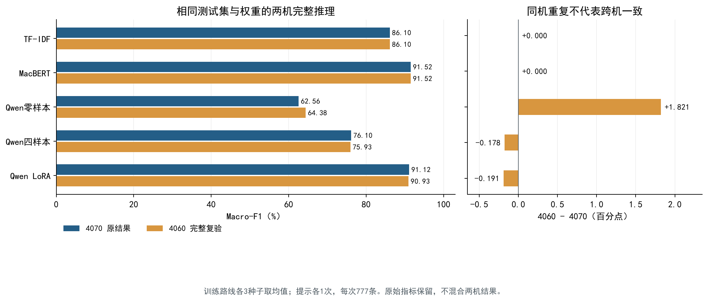

# 中文酒店评论情感分析：传统基线、提示学习与模型微调的效果及成本比较

**课程**：自然语言处理（2026—2027 秋季学期）　**组长学号／姓名**：20245726／刘广徽　**方向**：C——提示与微调对比

**成员与分工**：刘广徽（组长：选型、方案、LoRA、融合、对比与报告）；杨函齐（MacBERT全参微调、TF-IDF）；李嘉谊林（零样本、少样本）。三人学号依次为20245726、20246005、20245816；完整职责见第⑧节。

**提交日期**：2026年10月30日　**仓库地址**：[liuguanghui520/NLP](https://github.com/liuguanghui520/NLP/tree/main)　**演示录屏**：[百度网盘视频](https://pan.baidu.com/s/10l-SBqKrzkCp4hh3KQ8XAA?pwd=668w)，提取码`668w`（本机成片111.317秒；分享链接10月30日更新）


---

## 摘要

针对酒店评论情感二分类，比较TF-IDF逻辑回归、MacBERT及Qwen3-1.7B零／四样本、LoRA。数据按6210/776/777划分，验证Macro-F1选优，训练重复3种子。五方案原测试Macro-F1为86.10%、91.52%、62.56%、76.10%、91.12%。MacBERT、LoRA平均延迟6.13、59.06ms。两机复验中TF-IDF、MacBERT预测一致；零样本F1变化1.82个百分点，四样本、LoRA变化0.18、0.19个百分点。BF16生成有跨机得分和token排序差异，受控后端未消除分歧。MacBERT兼顾效果、成本及跨机稳定性，零样本需结合环境解释。

## ① 问题定义与背景

酒店评论同时包含卫生、位置、服务、价格等多个方面，既可能明确表达满意或不满，也可能夹杂比较、转折和酒店回复。本项目将评论整体情感划分为负面0或正面1，面向需要批量整理住客反馈、辅助发现差评的使用场景。当前成果是课程实验与可复现工程入口，尚未部署为实际业务服务。

研究问题是：在相同冻结数据上，传统稀疏特征、预训练编码器、生成式提示和参数高效微调分别取得怎样的分类效果？增加示例或监督训练是否改善Qwen表现？效果提升对应多少训练时间、推理延迟和资源占用？

成功判据采用可检查的工程及实验条件：五条路线均完成同一测试集的完整预测；按验证Macro-F1选参；至少完成一组参数比较与三类错误归因；保存配置、日志、逐样本输出和可独立重算的指标；同时报告延迟与资源。分类效果通过基线间差值评价，没有事后补设一个“达到某分即成功”的门槛。4070独立环境复现逐样本一致；4060已完整完成11次预测，85条跨机输出差异作为硬件稳定性实验结果报告。项目提供源码、依赖、固定资源链接和统一入口，供教师或AI按照README独立核验主要结果。

## ② 相关工作与方案选型

### 2.1 五种实验方案

按作业给出的技术路线，本项目组织五种情感分类方案，依次考察局部统计特征、预训练上下文表示、任务提示、示例引导和监督适配。它们共享冻结的数据划分与正式标签，通过统一评估比较效果和成本。

| 方案 | 表示与输出方式 | 如何适应情感任务 | 在实验中的作用 |
|---|---|---|---|
| 字符n-gram＋TF-IDF＋逻辑回归 | 字符片段转换为稀疏向量，由线性分类器输出0/1 | 在训练集拟合特征和分类器 | 传统非大模型基线，衡量轻量方案的能力 |
| MacBERT全参数微调 | 中文预训练编码器提取上下文表示，分类头输出两类分数 | 更新编码器、嵌入层和分类头全部参数 | 监督训练的预训练编码器基线 |
| Qwen3-1.7B零样本 | 读取中文任务说明，生成0/1 | 不更新权重，不提供任务示例 | 观察原始模型对任务说明的直接响应 |
| Qwen3-1.7B固定四样本 | 在同一任务说明前加入正负各两条标注示例 | 不更新权重，通过上下文展示判断与输出格式 | 观察示例引导带来的改善 |
| Qwen3-1.7B普通LoRA | 同一生成式基座，以标注答案训练增量矩阵 | 冻结基座、更新LoRA参数，推理不放示例 | 观察参数高效监督适配的效果与代价 |

TF-IDF与MacBERT均直接执行分类；Qwen三种方案通过生成标签完成分类。Qwen三种方案共用基座，但提示格式、示例数量和监督方式存在实际差异，后续按完整配置比较。

### 2.2 为什么选择这些模型和工具

TF-IDF字符特征减少中文分词词典依赖，n-gram保留局部搭配，逻辑回归提供简单稳定的分类参照[1]。MacBERT由哈尔滨工业大学与讯飞研究院联合实验室HFL提出，面向通用中文NLP，采用纠错式掩码等预训练设计；原研究包含ChnSentiCorp分类评测，因此具有任务相关的研究基础[2]。本项目加载预训练权重后对编码器、嵌入层和分类头进行全参训练。

选择Qwen3的实践起点是B站LoRA教程的推荐，[B站LoRA微调教程（BV1waZ2YDEcp）](https://www.bilibili.com/video/BV1waZ2YDEcp/)。这一系列支持中文等多种语言、提供多种参数规模和开放权重，并支持Transformers加载，便于本地实验。Qwen3还支持思考与非思考模式切换，本任务只需输出标签，因此关闭思考，控制额外生成[3]。结合RTX 4070 Laptop的8GB显存条件采用1.7B版本；实际运行已验证当前提示和普通LoRA配置可行。

LoRA通过冻结基座、训练低秩更新矩阵来减少可训练参数及对应训练状态[4]。采用普通LoRA使对照集中于秩、注入模块、学习率等设置，未引入量化变量。LLaMA-Factory的WebUI便于首次以可视化方式理解和配置微调流程，是选择该工具的重要原因[5]。后续保留实际配置与日志，使用PEFT、Transformers和PyTorch执行模型相关工作，SwanLab跟踪LoRA实验；统一评估使用项目脚本。BERT与TF-IDF搜索实际为脚本枚举，未将工具安装验证写成Optuna正式搜索。

### 2.3 三个课程原理点：解释、实验与证据

本节原理与参数增益采用4070原始实验；跨硬件稳定性另由两机完整复验及验证诊断检验。

**原理一：分词粒度与n-gram特征改变可学习的局部信息（第2、7讲）。** 字符n-gram统计相邻字符片段，词n-gram依赖分词边界；TF-IDF降低高频通用片段权重，线性分类器学习片段与情感标签的关联。这是稀疏特征分类，不是用n-gram概率直接计算句子困惑度。在相同训练／验证划分、C＝4、min_df＝2、特征上限20万下，字符1—3 gram验证Macro-F1为88.37%，词1—2 gram为87.20%，相差1.17个百分点；特征维度分别为130996、55013。字符2—5 gram达到20万维却只有87.75%，更大的特征空间未带来更高分。这支持本任务采用字符1—3 gram，也说明表示粒度需要用验证结果选择。案例6957中传统基线仍把其他酒店的推荐错归给当前酒店，提示局部片段对目标关联的表达存在局限；目前没有特征贡献或干预实验，不把该线索说成已经证明的内部机制。详见5.5和6.1。

**原理二：提示、SFT与LoRA改变模型的方式不同（第13—14讲）。** 零样本和少样本不更新权重；少样本通过输入上下文展示标签与格式。SFT利用标注答案的监督损失更新参数，LoRA则冻结基座，将更新限制为低秩矩阵（公式见4.5）。本项目同一Qwen3-1.7B基座的零／四样本／LoRA测试Macro-F1为62.56%／76.10%／91.12%，非法率为20.33%／0.26%／0。四条示例提高13.55个百分点并大幅减少格式错误；LoRA进一步提高15.01个百分点，说明额外监督适配的收益已超出剩余2条格式错误。相同可训练参数3211264下，T01覆盖q/k/v/o的验证F1为91.39%，高于仅q/v、r16的91.05%，说明更新位置也影响适配效果。三种提示的具体格式及监督量并不完全相同，因此比较完整方案；多对象案例6865表明微调仍有适用边界。

**原理三：类别不均衡与非法生成决定评测口径（第14—15讲）。** Accuracy按全部样本等权，Macro-F1先分别计算正负两类F1再等权平均，少数类不会被多数类数量直接淹没。训练集多数类为正面；固定全部预测正面，在测试集532正／245负上得到Accuracy＝532/777＝68.47%，但负面召回为0，Macro-F1仅40.64%。固定四样本的负面召回虽达96.73%，却把172条正面判成负面，负面精确率仅57.95%，Macro-F1为76.10%；只看单类召回会得出片面结论。零样本158条非法输出保留在777条分母中，并对真实类别计漏判，否则会掩盖格式失败。由此统一采用验证Macro-F1选优，辅以Accuracy、分类别P/R/F1、非法率与混淆矩阵，测试不参与选参。指标公式及逐运行汇总见5.1—5.4。

上述三点均对应已运行数据。MacBERT的MLM方向与Qwen的AR方向仅作为模型背景；项目未执行预训练目标受控实验、PPL或词向量／句向量对照，不将这些概念列作已经完成的原理验证。

### 2.4 选型边界：为什么包含微调、不引入RAG

作业方向C要求比较提示与微调，因此同时保留无需更新权重的提示、MacBERT全参微调和普通LoRA；TF-IDF提供非大模型基线。当前任务只判断给定评论的整体情感，不依赖外部事实检索，故不增加RAG及其检索库、召回和引用链路。没有另造两个未运行的备选方案实验；选型通过上述五路线的真实对照说明。

## ③ 系统设计

### 3.1 总体架构与数据流


图3-1　数据清洗与划分仅在冻结前完成；模型训练、验证选优与最终测试分别组织。权重保留在个人工具目录，统一项目保存配置、资源关联、预测和证据。

原始CSV经最小清洗和去重，形成共享JSONL与LoRA所需Alpaca格式。训练集用于拟合特征、模型训练和少样本示例选择；验证集用于选配置和检查点；冻结后对测试集预测。各路线输出同一协议的逐样本记录，交由统一评估入口计算指标和错例，再生成图表与报告素材。

### 3.2 模块与职责

| 模块 | 具体负责人 | 主要产物与交付接口 |
|---|---|---|
| 共享数据、冻结规则与跨路线对齐 | 刘广徽统筹；杨函齐、李嘉谊林分别核对各自输入 | `data/manifests/`、冻结ID、JSONL／Alpaca与哈希核查 |
| TF-IDF与MacBERT训练 | 杨函齐 | `src/legacy/baselines/`、4／8组验证对照、各3种子结果和日志 |
| Qwen零样本／四样本提示 | 李嘉谊林 | `src/legacy/prompt/`、提示注册表、固定示例ID、验证与测试预测 |
| Qwen普通LoRA训练 | 刘广徽 | `src/legacy/lora/`、10组搜索、T01补种子、配置及Trainer日志 |
| 模型接入、CLI与统一评估 | 刘广徽；两名路线负责人提供源包并核查接入 | `src/adapters/`、`src/cli.py`、`src/evaluation/`、统一逐样本协议 |
| 对比、错例与图表 | 刘广徽 | `src/analysis/`、`reports/analysis/`、九例审核与模型／参数结论 |
| 报告、演示、打包与提交统筹 | 刘广徽；各成员确认各自声明 | 本报告、Cherry Studio演示、三份贡献声明、复现说明与ZIP清单 |

预测记录包含样本ID、真值、原始输出、解析标签、状态、输入字符和token长度、截断标记及耗时。新运行使用唯一ID和全新目录；失败、重试和历史结果分别保留。

## ④ 实现细节

### 4.1 数据处理与冻结

使用ModelScope `AiNiklaus/ChnSentiCorp`中的酒店评论CSV，共7766条。只统一换行符、去首尾空白，保留否定词、标点及原始文本；先核查全文重复，再生成前512个Unicode字符的共享正文。排除1条空文本和2条重复截断前缀，得到7763条有效记录，最终203条需要字符截断。前缀碰撞按已确认规则保留源序号最小记录。

| 划分 | 数量 | 负面0 | 正面1 |
|---|---:|---:|---:|
| 训练 | 6210 | 1954 | 4256 |
| 验证 | 776 | 244 | 532 |
| 测试 | 777 | 245 | 532 |

本项目以该CSV重新分层划分：先取20%临时集，再将其等分为验证与测试，两次种子均67。划分并非原论文的9600/1200/1200设置。冻结后ID集合互斥、精确重复前缀无跨集碰撞；未实施近似语义去重。成员来源数据的Alpaca正文哈希和ID顺序已对齐，通用JSONL序列化差异及未能逐字核对的历史部分保留在审计中。

实现上，将“原文保留”“共享输入”“模型专用格式”分开处理：JSONL底稿保存原文、规范化正文、标签、源序号和划分；模型共享前512字符；Alpaca将任务说明、正文和数字答案映射到`instruction/input/output`。少样本示例、预热和延迟子集由固定ID索引关联，不另造一套真值。排除记录保存原因及被保留的ID，避免只留下清洗后的总数。

| 数据处理检查 | 实际记录 | 作用 |
|---|---|---|
| 数量守恒 | 7766＝7763有效＋1空文本＋2前缀碰撞排除 | 每条源记录的去向可追溯 |
| 前缀碰撞 | 3071保留对应3070；3729保留对应3728 | 冻结前处理模型实际输入相同的记录 |
| 稳定ID | `源文件SHA256:source_row` | 合并不同代码来源时仍可逐样本对齐 |
| 划分与子集 | 划分、少样本、冒烟、延迟ID及其顺序单独保存 | 训练种子变化不重划数据 |
| 内容校验 | JSONL、Alpaca、配置及脚本记录SHA256 | 区分文件序列化变化和实际正文变化 |

模型输入还要经过token预算检查。MacBERT在512 token内保留特殊符号；Qwen预算包含任务说明、聊天模板和少样本示例。超限时只缩短目标评论，不截掉任务说明或示例。字符截断与token截断使用不同字段记录，使后续能核查模型实际看到了什么。

### 4.2 最终训练与推理配置

| 路线 | 实际配置 |
|---|---|
| TF-IDF＋LR | 字符1—3 gram，`min_df=2`，最多20万特征，sublinear TF；LR的C=4，lbfgs，max_iter=2000，不加类别权重；仅在训练集拟合 |
| MacBERT | `hfl/chinese-macbert-base`预训练全参；token上限512，batch8，累积1，最多3轮；AdamW，lr2e-5，weight_decay0.01，warmup0.1，linear，裁剪1.0，FP32 |
| Qwen零／少样本 | `Qwen/Qwen3-1.7B`，总输入上限2048 token，BF16，关闭思考，贪心、单束、最多8个新token；超限仅从评论尾部截断 |
| 普通LoRA T01 | 同Qwen基座，r8、alpha16、q/k/v/o、dropout0.05；3轮，lr1e-4，AdamW，weight_decay0，warmup0.1，linear；microbatch1、累积16，BF16、梯度检查点，仅答案token计算loss |

MacBERT共有102269186个可训练参数；LoRA最终T01为3211264个可训练参数。MacBERT基座锁定revision `a986e004d2a7f2a1c2f5a3edef4e20604a974ed1`。Qwen提示注册表记录revision `4855588ea1a12789f2e965e5f52a9e4a24c94b2a`；LoRA原始下载revision未确认，统一评估实际按本地基座文件SHA256锁定，不将注册表字段当成全部历史下载证据。

零样本任务提示为：

```text
判断评论整体情感，仅输出0表示负面、1表示正面。

<评论>
{{comment}}
</评论>
```

少样本在同一聊天模板中加入训练集正负各两条，按负、正、负、正排列；固定ID尾号5542、3812、5693、4407，正文可由冻结训练集恢复。LoRA训练与推理不放示例，采用“同一任务说明＋单换行＋评论”。不同路线的格式如实保留，未在测试后改写成相同提示。配置证据见[提示注册表](../../../configs/methods/prompt_registry.json)、[LoRA冻结配置](../../../configs/methods/lora-frozen.json)及[基线配置](../../../results/evidence/formal-analysis-20261028-01/bert/bert-len512-seed42/config.json)。

### 4.3 传统基线：从特征构建到可重载Pipeline

TF-IDF与逻辑回归封装在同一Pipeline中，先在训练集拟合字符片段词表和逆文档频率，再对验证／测试文本执行转换。由此固定“哪些数据可以更新特征统计”的边界。实际使用次线性词频和带平滑的逆文档频率，对出现过的片段t，其未归一化权重可写为：

$$
w_{t,d}=(1+\ln f_{t,d})\left[\ln\left(\frac{1+N_{\mathrm{train}}}{1+\mathrm{df}_t}\right)+1\right],\qquad f_{t,d}>0
$$

其中，$f_{t,d}$为片段t在评论d中的出现次数，$\mathrm{df}_t$为含该片段的训练评论数；未出现片段权重为0，向量随后进行L2归一化。逻辑回归依据稀疏特征预测类别，四组特征配置均保存拟合时间、特征维度、迭代次数、警告和训练／验证log-loss。

字符1—3 gram、种子42的实际记录为：特征130996维，优化36次迭代，拟合6.0282秒，训练log-loss为0.143556、验证log-loss为0.275940，验证Macro-F1为0.883748。保存Pipeline后重载并核对预测，三个种子的最终结果全部保留。逻辑回归只保存实际最终值，不伪造训练逐步曲线。

### 4.4 MacBERT：全参训练、逐轮选优与恢复检查

加载预训练编码器后，分类头将池化表示映射为两类概率：

$$
\mathbf p(x)=\operatorname{softmax}(W_c\mathbf h_{\mathrm{pool}}(x)+\mathbf b_c),\qquad
\hat y=\arg\max_{c\in\{0,1\}}p_c(x)
$$

使用分类交叉熵训练，编码器、嵌入层和分类头全部参与梯度更新。每个batch保存步数、轮次、loss、当前学习率和实测batch耗时；每轮保存验证预测及指标，并按验证Macro-F1更新最佳检查点。训练与测试入口分离，队列完成后才衔接冻结配置的测试。

以下两行逐字摘自`bert-len512-seed42/train_steps.jsonl`，`seconds`为该batch记录区间耗时，不是从启动到结束的完整时间：

```json
{"step": 1, "epoch": 1, "loss": 0.7207541465759277, "lr": 8.583690987124465e-08, "seconds": 0.2948879670000224}
{"step": 2, "epoch": 1, "loss": 0.740314245223999, "lr": 1.716738197424893e-07, "seconds": 0.16876767700000528}
```

同一次运行的逐轮记录如下，表中耗时来自对应日志，不含全部保存等开销：

| 轮次 | 训练loss | 验证Macro-F1 | 训练记录秒数 | 验证秒数 | 检查点决定 |
|---|---:|---:|---:|---:|---|
| 1 | 0.344469 | 88.5968% | 83.5057 | 6.2563 | 当前最佳 |
| 2 | 0.215189 | 90.8144% | 83.1852 | 6.3012 | 更新最佳 |
| 3 | 0.115225 | 90.8733% | 83.0655 | 6.3806 | 最终选择 |

保存内容包含模型、优化器、学习率调度器与随机状态，冒烟检查覆盖epoch边界恢复和保存后重载预测。最终种子43在第1轮达到其验证最佳，因此各运行分别恢复最佳检查点，不统一使用最后一轮。8组搜索加2次补种子共10次正式训练均有配置和逐步／逐轮证据。日志来源见[原始BERT证据](../../../results/evidence/formal-analysis-20261028-01/bert/bert-len512-seed42/epoch_metrics.jsonl)。

### 4.5 LoRA：答案掩码、参数注入与有效批量

对选定投影矩阵，LoRA将参数更新写为：

$$
W=W_0+\Delta W=W_0+\frac{\alpha}{r}BA
$$

其中$W_0$为冻结基座权重，$A$和$B$为可训练低秩矩阵，r为秩；本项目最终r＝8、alpha＝16。训练输入包含任务说明与评论，只有答案位置集合$\mathcal A$参与自回归损失：

$$
\mathcal L_{\mathrm{answer}}=-\frac{1}{|\mathcal A|}\sum_{t\in\mathcal A}\ln p_{\theta}(y_t\mid x,y_{<t})
$$

任务说明和评论位置不计算监督loss，避免把复述输入当成训练目标。BF16、梯度检查点与梯度累积配合使用；单卡有效批量为：

$$
B_{\mathrm{有效}}=B_{\mathrm{微批量}}\times K_{\mathrm{累积}}\times G_{\mathrm{设备数}}=1\times16\times1=16
$$

LLaMA-Factory配置记录`train_on_prompt=false`、`gradient_checkpointing=true`、`overwrite_output_dir=false`，每10步记录日志，每轮保存后以生成标签的验证Macro-F1选检查点。以下为T01原始Trainer日志的前两条：

```json
{"current_steps": 10, "total_steps": 1167, "loss": 5.128038787841797, "lr": 7.692307692307694e-06, "epoch": 0.02576489533011272, "percentage": 0.86, "elapsed_time": "0:00:31", "remaining_time": "1:00:35"}
{"current_steps": 20, "total_steps": 1167, "loss": 4.390075302124023, "lr": 1.623931623931624e-05, "epoch": 0.05152979066022544, "percentage": 1.71, "elapsed_time": "0:00:59", "remaining_time": "0:56:35"}
```

这两条loss是相应日志窗口的统计，不能仅凭前20步判断泛化。T01种子42第1／2／3轮验证Macro-F1依次为90.4138%、90.8723%、91.3885%，最佳为第3轮`checkpoint-1167`。训练配置、`trainer_log.jsonl`、`trainer_state.json`、逐轮验证与`best_checkpoint.json`相互关联。10组搜索和T01补种子43、44共12个成功运行的日志保留；中途失败批次另存，不覆盖。来源见[T01原配置](../../../results/qwen17-comparisons/qwen17-comparisons-20261026-012117-9e8e51/T01/train.json)、[逐轮验证](../../../results/qwen17-comparisons/qwen17-comparisons-20261026-012117-9e8e51/T01/validation_history.json)。

### 4.6 提示恢复、统一接口与证据链

零／少样本负责人提供的历史包包含提示注册表及示例ID，但部分示例正文脱敏。融合时按四条训练ID恢复正文，核查标签、文本哈希和聊天模板哈希，再复核两种提示共1552条历史验证输入的渲染哈希。正式评估不凭手工复制的几段提示替代历史配置。

工程入口将不同来源转成统一协议，训练、预测、评估分别组织。每条预测保存`sample_id`、`true_label`、`raw_output`、`parsed_label`、`status`、长度、截断、token数与耗时；运行索引保存模型、检查点、配置、种子、源产物哈希和正式／冒烟阶段。严格解析核心逻辑为：

```python
def parse(raw):
    return int(raw.strip()) if isinstance(raw, str) and raw.strip() in ("0", "1") else None
```

上段与实际函数逻辑一致；评估还检查样本数量、ID顺序、重复ID、真值、划分、原始输出与解析状态是否一致。格式非法是一次完整预测中的任务失败；OOM、超时、漏预测等基础设施失败则阻止发布完整主成绩。两种情况不合并处理，修复重跑使用新ID。

| 可核查工作 | 已保存证据与检查范围 |
|---|---|
| 三方代码接入 | 传统基线、MacBERT、提示与LoRA统一到`src/cli.py`；原代码归档保留 |
| 基线审计 | 10次BERT、6次TF-IDF，最佳轮次、模型／Pipeline哈希和重载预测 |
| 正式预测对齐 | 16份验证／测试记录，11份最终测试每份777条；统一重算指标 |
| 正式推理计时 | 11份同200条延迟记录，固定20条训练评论预热，GPU计时同步 |
| 训练过程追溯 | 补取54份既有训练日志／配置证据并校验；BERT和LoRA分图 |
| 软件检查 | 本次完整仓库88项、随包71项工程检查；验证完整性、状态、指标和异常处理，不代替模型效果评价 |

由此形成“源数据与配置→模型／适配器→逐样本预测→统一指标→图表→报告结论”的关联链。具体代码见[提示适配](../../../src/adapters/prompts.py)、[严格评估](../../../src/evaluation/metrics.py)，已有软件检查记录见[30项检查日志](../../../logs/comparison-checks/resource-adapter-20261029-01/unittest.log)。运行证据覆盖配置、训练、预测、评估及图表生成。

### 4.7 关键问题与解决记录

| 实际问题 | 处理方式与验证 |
|---|---|
| 原基线包按Accuracy选优，缺少可核查的各轮验证产物 | 统一改为验证Macro-F1；重新执行8组BERT与4组TF-IDF搜索，保存每轮指标、配置、模型和验证预测 |
| 冒烟前32条仅含正类，逻辑回归拟合失败 | 保留原失败状态，改用两类各16条的冒烟子集重试；不计入正式成绩 |
| 首次预热ID查询划分错误 | 按全部冻结划分查找原ID，不重新抽样或改变预热ID |
| 首次TF-IDF延迟与BERT训练重叠 | 原记录留档；正式采用后续独立`test-isolated`测量 |
| 提示来源包示例正文被脱敏 | 按固定训练ID恢复，并核验示例文本及历史验证输入哈希 |
| 不同路线输出与指标不一致 | 统一严格0/1解析、非法计错、完整ID校验及独立重算；首次失败与重试关联记录 |

模型保存后重载核查预测；BERT验证了epoch边界模型、优化器、调度器和随机状态恢复。未将这一检查扩大描述为任意step精确恢复或所有路线完整续训。

### 4.8 环境

硬件为Intel Core i7-14650HX（16核24线程）、16GiB内存、RTX 4070 Laptop GPU（8188MiB显存）。模型运行于Windows宿主下WSL2 Ubuntu22.04.5，Python3.11.17、PyTorch2.14.1、Transformers5.8.0、PEFT0.18.1、scikit-learn1.9.1、LLaMA-Factory0.9.6.dev0。MacBERT使用FP32，Qwen使用BF16，模型推理在本机完成，没有按token付费的模型API调用。

环境标识E01：硬件与驱动于2026-10-29补采，训练与推理使用同一硬件和基础环境，配置已经确认。驱动616.92，驱动报告CUDA支持13.4，PyTorch CUDA构建13.0；独立Toolkit版本未确认。离线统计绘图为Windows Python3.13.9、NumPy2.3.5，单独记录。完整来源见[环境说明](../../environment/实验运行环境与延迟口径.md)。

## ⑤ 评估

本节基于冻结测试预测、原始运行日志与已确认的案例分析，围绕分类效果、两类取舍、输出合规、稳定性和参数收益给出结论；成本、延迟与资源统一在第⑦节讨论。测试结果与验证选参结果分表，所有新增汇总只读取已有预测和日志。

### 5.1 数据、指标与汇总口径

测试集777条，负面245条、正面532条，数据来源与划分见4.1。以整条评论为评价单位。对类别$c\in\{0,1\}$，$TP_c$表示真实与预测均为c的条数，$FP_c$表示其他类别被预测为c的条数，$FN_c$表示真实为c却未正确识别的条数。精确率关注“判为该类的有多少正确”，召回率关注“该类实际样本中找回多少”：

$$
\begin{aligned}
\mathrm{Precision}_c&=\frac{TP_c}{TP_c+FP_c}\\
\mathrm{Recall}_c&=\frac{TP_c}{TP_c+FN_c}\\
F1_c&=\frac{2\,\mathrm{Precision}_c\,\mathrm{Recall}_c}{\mathrm{Precision}_c+\mathrm{Recall}_c}
=\frac{2TP_c}{2TP_c+FP_c+FN_c}
\end{aligned}
$$

精确率和召回率的调和平均形成类别F1；宏平均对两类等权，加权F1则按真实类别数量$n_c$加权：

$$
\mathrm{Macro\!-\!F1}=\frac{F1_0+F1_1}{2},\qquad
\mathrm{Weighted\!-\!F1}=\sum_{c=0}^{1}\frac{n_c}{N}F1_c
$$

准确率和非法输出率分别为：

$$
\mathrm{Accuracy}=\frac{\text{预测正确的评论条数}}{N},\qquad
\mathrm{InvalidRate}=\frac{\text{未严格输出0或1的评论条数}}{N}
$$

分母为零时相应值记0。Qwen输出仅去首尾空白，完整等于0或1才合法；非法输出仍计入$N$，对真实类别形成漏判，不从测试集中删除，也不取首数字重新评分。混淆矩阵保留“预测负面、预测正面、非法”三列。基础设施失败导致预测不完整时，不发布完整主指标。

选择参数和检查点使用验证Macro-F1；Accuracy与Weighted-F1为辅助，避免多数类掩盖差评漏判。训练方案对三个种子分别计算指标，再求均值与样本标准差：

$$
\bar m=\frac{1}{S}\sum_{s=1}^{S}m_s,\qquad
\mathrm{SD}(m)=\sqrt{\frac{1}{S-1}\sum_{s=1}^{S}(m_s-\bar m)^2},\qquad S=3
$$

训练种子为42、43、44；提示采用确定性单次。数据划分种子67与统计重采样种子67用途不同。下文百分点差均从未舍入值计算。历史测试已被查看，案例及概率分析属于事后解释；后续改进应另立版本。

### 5.2 主结果：MacBERT与LoRA领先，跨机差异集中于Qwen

|方案|宏平均F1|准确率|加权F1|非法率|
|---|---|---|---|---|
|多数类参考：全部正面|40.64／40.64|68.47／68.47|55.65／55.65|0.00／0.00|
|TF-IDF＋逻辑回归|86.10／86.10|88.42／88.42|88.20／88.20|0.00／0.00|
|MacBERT全参微调|91.52／91.52|92.62／92.62|92.65／92.65|0.00／0.00|
|Qwen零样本|62.56／64.38|59.59／61.65|66.16／67.84|20.33／18.79|
|Qwen固定四样本|76.10／75.93|76.58／76.45|77.44／77.28|0.26／0.13|
|Qwen普通LoRA|91.12／90.93|92.28／92.11|92.30／92.13|0.00／0.00|

表1　两机完整测试主结果，单元格均为“4070／4060”，单位%。各机使用同一777条测试集、权重、提示与锁定依赖；训练路线各3种子取均值，零／四样本各1次。多数类为共同参考。两机结果分别保留，不混合求均值；更精确的F1及差异见表1b。

以两机实际测试数据为基准，MacBERT的Macro-F1均为91.518%，TF-IDF均为86.104%，两条路线逐样本预测一致。Qwen零样本为62.559%／64.380%，跨机差1.821个百分点；四样本为76.105%／75.927%，差0.178个百分点；LoRA为91.116%／90.925%，差0.191个百分点。两机均保持MacBERT、LoRA、TF-IDF、四样本、零样本的效果排序。因此MacBERT兼顾本次分类效果、成本和跨机稳定性，TF-IDF提供稳定轻量参照；LoRA与四样本有小幅硬件相关波动，零样本波动更明显。这里的两机区间是已观测基准，不是所有硬件的误差上界。

加入四条示例，4070／4060的Macro-F1分别提高13.55／11.55个百分点；LoRA相对四样本分别提高15.01／15.00个百分点。LoRA监督适配和示例引导的收益在两机都存在，但单个增益值受推理环境影响。四样本非法输出为2／1条，零样本为158／146条，LoRA两机均为0；因此LoRA相对四样本的主要优势仍是情感判断改善。精度和硬件相关差异作为实验结果一并报告，不删除零样本。


**跨机稳定性纳入主结果。**

| 方案 | 4070原Macro-F1 | 4060复验Macro-F1 | 差值（百分点） | 输出差异数 | 本次跨机表现 |
|---|---:|---:|---:|---:|---|
|TF-IDF|86.104%|86.104%|+0.000|0|逐样本一致|
|MacBERT|91.518%|91.518%|+0.000|0|逐样本一致|
|Qwen零样本|62.559%|64.380%|+1.821|72|环境差异明显|
|Qwen四样本|76.105%|75.927%|-0.178|7|有差异，幅度较小|
|Qwen LoRA|91.116%|90.925%|-0.191|6|有差异，幅度较小|

表1b　原4070结果与4060完整复验。差异按“运行×样本”计数，TF-IDF、MacBERT及LoRA各含3个种子，其余各1次；两机均为11次×777条。85条输出差异中61条改变解析标签。成本仍采用环境E01，不混合两机成绩。

两机排名均为MacBERT、LoRA、TF-IDF、四样本、零样本。TF-IDF和MacBERT的指标及逐样本预测一致；零样本Macro-F1变化+1.821个百分点、Accuracy变化+2.059个百分点，跨机波动最明显；四样本和LoRA的Macro-F1分别变化−0.178、−0.191个百分点，幅度较小，但不等于逐样本一致或已证明统计等效。因此主结论同时考虑分类效果、成本和本次跨机稳定性，保留零样本及其局限。



图5-1　原4070与4060完整复验的Macro-F1；训练方案均逐种子计算后取平均。右图为4060减4070的百分点差，零差值仅表示本次实测一致。

### 5.3 分类别表现与非法生成：高负面召回不等于整体最好

以下分类别指标和混淆矩阵采用4070原始记录；两机整体结果与非法率已在主表并列，避免将不同环境的分类别值混合。

|方案|类别|真实条数|精确率P|召回率R|类别F1|
|---|---|---|---|---|---|
|TF-IDF＋逻辑回归|负面0|245|86.05|75.51|80.43|
|TF-IDF＋逻辑回归|正面1|532|89.32|94.36|91.77|
|MacBERT全参微调|负面0|245|87.39|89.66|88.46|
|MacBERT全参微调|正面1|532|95.19|93.98|94.57|
|Qwen零样本|负面0|245|61.75|46.12|52.80|
|Qwen零样本|正面1|532|80.28|65.79|72.31|
|Qwen固定四样本|负面0|245|57.95|96.73|72.48|
|Qwen固定四样本|正面1|532|97.81|67.29|79.73|
|Qwen普通LoRA|负面0|245|86.85|88.98|87.90|
|Qwen普通LoRA|正面1|532|94.87|93.80|94.33|

表2　同一测试集的分类别精确率、召回率和F1，单位%。训练路线先分别计算每个种子的类别指标再平均；固定两类真实数量为负245、正532。该表的类别F1均值不由平均P、R再次计算。

TF-IDF正面召回94.36%，负面召回75.51%，主要不足是漏掉部分差评。少样本负面召回96.73%，识别出245条负面中的237条，但将172条正面判成负面，负面精确率仅57.95%。MacBERT和LoRA负面召回约89%、正面召回超过93%，两类判断更均衡。

零样本非法158/777＝20.33%，少样本2/777＝0.26%，LoRA三个种子均为0。案例5773中零样本用自然语言表达了正确负面，却未输出数字；案例5546则输出合法1而判断错误，两种失败机制需要区分。少样本同时改善分类与格式，但零样本的全部低分不能都解释为格式问题。

多数类参考行得到68.47%的Accuracy，却完全无法识别负面，Macro-F1仅40.64%。这也解释了为何以Macro-F1主导选优，并同时查看类别指标与混淆矩阵。

### 5.4 三种子稳定性及MacBERT与LoRA的差距

本节种子分布与bootstrap分析均针对4070原始预测，不是跨硬件一致性检验。MacBERT领先LoRA的F1差距在4070为0.402个百分点、在4060为0.593个百分点，方向一致；原约70%的bootstrap胜出比例不外推为跨硬件概率。

|方案|种子42|种子43|种子44|均值|SD／百分点|
|---|---|---|---|---|---|
|TF-IDF＋逻辑回归|86.10%|86.10%|86.10%|86.10%|0.000|
|MacBERT全参微调|91.65%|91.12%|91.78%|91.52%|0.346|
|Qwen普通LoRA|91.27%|90.98%|91.10%|91.12%|0.149|

表3　每个训练种子的测试Macro-F1及汇总。SD以百分点表示；提示不重复相同确定性运行充当独立随机实验。

MacBERT平均比LoRA高0.40个百分点，LoRA三次训练的SD为0.149个百分点，小于MacBERT的0.346个百分点，观察到的分数波动更小。案例7015中只有MacBERT种子44误判，说明总体均值之外仍需保留样本级差异。

为回答“有多大把握认为MacBERT更好”，沿用已确认的简化配对分层贝叶斯bootstrap：类别内抽取Dirichlet权重，同一条评论的权重共享给六个已训练模型，分别计算三个种子均分差。种子67、10000次中6991次MacBERT均分更高：

$$
\widehat{\Pr}\!\left(\overline{F1}_{\mathrm{MacBERT}}>\overline{F1}_{\mathrm{LoRA}}\right)
=\frac{6991}{10000}=0.6991\approx70\%
$$

这一条件概率略偏向MacBERT，两者效果接近。另一个5000次配对bootstrap的差值95%区间为−1.07至1.93个百分点，仍包含0。两项统计描述固定模型与当前样本构成，不把检验p值换成优胜概率。[方法与原预测哈希](../../../reports/analysis/conclusions-confirmed-20261029-01/贝叶斯概率估计.json)

### 5.5 路线内参数对照与最终配置

本节全部使用验证集776条、种子42，不混用测试成绩。先给出三条训练路线的代表对照，再汇总其余参数证据。

**TF-IDF特征对照。** 固定C＝4、min_df＝2、特征上限20万：

| 特征 | 验证Macro-F1 | 特征维度 |
|---|---:|---:|
| 字符2—4 gram | 88.09% | 192406 |
| 字符1—3 gram | 88.37% | 130996 |
| 字符2—5 gram | 87.75% | 200000 |
| 词1—2 gram | 87.20% | 55013 |

字符1—3 gram比词方案高1.17个百分点，选作最终基线。字符2—5达到特征上限，分数却没有提高，说明扩大表示规模不必然改善任务表现。

**MacBERT学习率与长度配置。** 在长度256、batch16、最多3轮时，学习率1e-5／2e-5／5e-5的验证Macro-F1为90.47%／90.62%／90.49%，2e-5稍优。沿用该学习率比较长度与批量：

| token上限 | batch | 验证Macro-F1 |
|---|---:|---:|
| 128 | 16 | 89.42% |
| 256 | 16 | 90.62% |
| 512 | 8 | 90.87% |

最终选择512配置，相对256提高0.26个百分点。这是长度和batch的组合对照，其时间开销放在7.2。

**LoRA秩与注入模块。** 保持alpha/r＝2：

| 配置 | 注入模块 | r／alpha | 可训练参数 | 验证Macro-F1 |
|---|---|---|---:|---:|
| B00 | q/v | 8／16 | 1605632 | 90.95% |
| R01 | q/v | 16／32 | 3211264 | 91.05% |
| T01 | q/k/v/o | 8／16 | 3211264 | 91.39% |

q/v秩翻倍，可训练参数翻倍，F1仅提高0.10个百分点。T01与R01可训练参数相同，扩大模块覆盖比只增大q/v秩高0.34个百分点，因此选择T01补种子43、44。其余参数证据如下：

| 对照 | 验证结果 | 解释与取舍 |
|---|---|---|
| BERT类别加权 | 256不加权90.62%，加权90.72%；负面召回87.70%→89.75%，正面93.80%→92.86% | 改善少数类检出，也牺牲部分正面召回；512＋加权未测试 |
| BERT训练预算 | 最多3轮90.62%；5轮90.79% | 小幅收益约0.18个百分点；总步数也改变调度，耗时见7.2 |
| BERT部分冻结 | 全参90.62%；冻结嵌入及底6层89.86% | 可训练参数102269186→43119362；两组学习率也不同，工程取舍见7.2 |
| LoRA学习率 | 5e-5／1e-4／3e-4：90.56%／90.95%／90.07% | 保留1e-4 |
| LoRA warmup | 0.05／0.10／0.20：90.95%／90.95%／90.22% | 保留基准0.10，同分不代表逐条预测相同 |
| LoRA衰减 | q/v linear90.95%、cosine91.21%；T01 linear91.39% | cosine改善基准，但最终完整候选T01仍最高；T01＋cosine未测 |
| LoRA dropout | 0.02／0.05／0.10：90.68%／90.95%／90.81% | 保留0.05，收益小于本次模块调整 |

上述连同TF-IDF、BERT学习率／长度和LoRA秩／模块，共对应十二项已确认参数结论。最终采用char_1_3、MacBERT全参len512/lr2e-5、LoRA T01。搜索为有限单种子候选，优胜者补43、44，没有把未运行组合的收益相加。完整条件见[参数结论](../../../reports/analysis/conclusions-confirmed-20261029-01/参数对比结论.md)。

### 5.6 训练曲线与检查点：loss下降不等于验证持续改善

MacBERT len512种子42三轮训练loss从0.344469降至0.115225，验证Macro-F1从88.5968%升至90.8733%；LoRA T01种子42三轮验证Macro-F1从90.4138%升至91.3885%。这些过程可与第④节日志和附录C曲线逐项核对。

预算对照中，BERT最多5轮的训练loss从0.3447继续降到0.0298，但验证最佳在第1轮，后续没有持续提高。训练loss衡量训练样本拟合，最终检查点仍按验证F1选择。TF-IDF只记录最终训练／验证log-loss和36次优化迭代，不补绘逐步曲线。

BERT分类loss与LoRA答案token loss定义不同，分别展示。BERT按步曲线和累计batch实测时间不等于完整墙钟；LoRA按每10步窗口及Trainer耗时绘制。训练过程图反映真实记录，不以平滑或补点掩盖波动。

### 5.7 输入长度与截断的检查

共享输入先取前512字符，再检查各模型token预算。测试集中757条不需字符截断、20条需截断；后者样本数小于30，只作描述。长度与token子群还受到类别比例、示例占用和未知字段影响，不将观察到的分组分数差直接解释为截断造成的损失。

这项检查帮助错误分析排除不符合证据的解释。例如案例5546仅38字符、4086仅49字符、6197仅100字符且没有记录到相应截断，不能将这些错误简单归因于评论太长。完整长度分布、token状态和子群数量保留在[正式图表总览](../../../reports/analysis/comparison-formal-20261028-03/图表总览.html)及对应JSON中。

## ⑥ 错误分析与局限

### 6.1 五类失败及改进方向

本节九例及错例数量来自4070原始预测，用于解释该环境的失败；4060的跨机变化另行统计，不改写原案例或将两机错例混作同一组金标。

从11个测试运行取错误并集，得到402条去重评论、1118个错误“样本—运行”组合。人工试标20条，其余382条由AI按确认规则辅助标注；本节九例解释及正文编排经人工逐项审核。正式报告采用这九例作定性分析，不再逐条复核其余124条未纳入人工定稿材料；已有AI归因数量仅保留为探索性附录，不写成人工定稿的分类比例。五组正文共七例，另两例讨论标签和稳定性。全部777条测试评论仍用于正式评分。具体范围见[错例与数据使用核查](../../报告素材/错例范围与数据使用核查-20261029.md)。

| 类别／案例ID尾号 | 失败样例：输入线索→实际输出 | 归因与局限 | 可能的改进 |
|---|---|---|---|
| 任务适应性／5546 | “很差，相当差”，真值负面→仅零样本合法输出1；其余路线正确 | 当前提示下，原始模型仍会误判明确情感；38字符，无记录到的截断 | 代表性示例或监督适配；本例已被少样本和LoRA修正 |
| 混合评价／6353、4086 | 卫生差但肯定前台，负面→TF-IDF三种子判正；弱肯定夹杂缺点，正面→零／少样本判负 | 整体与局部评价取舍会在两个方向失败；6353零样本另属格式错误 | 核查特征贡献，以正负两方向混合评价验证分句或方面特征 |
| 多评价对象／6865、6957 | 当前酒店差、另一酒店更好，负面→6957仅TF-IDF三种子判正；6865多个监督模型仍判正 | 不同酒店、平台和方面的情感归属可能混淆 | 明确目标对象并验证边界标记，同时检查单对象样本退化 |
| 多说话者／6197 | 住客批评后附酒店回复，负面→TF-IDF、MacBERT、LoRA三种子及少样本共10次判正 | 回复与住客立场不同；也可能受开头肯定影响 | 对照原文、角色标记、仅住客正文，核查实际收益 |
| 格式遵循／5773 | 扣房费、不满意，负面→零样本输出“根据评论内容，整体情感偏向负面。” | 语义表达负面但不满足数字协议，正式计非法；其余运行正确 | 验证限定0/1完整序列的解码约束，联合检查分类、非法率和延迟 |

多对象主例6865中，MacBERT42/44、TF-IDF及LoRA三个种子均判正，MacBERT43和少样本判负；零样本输出1后解释，正式为非法。该例说明微调后仍存在复杂比较错误。固定少样本在4086也未修正弱正面误判，因此案例5546的改善不外推为“少样本或微调消除所有错误”。

### 6.2 数据、稳定性及覆盖局限

案例647源标签正面而人工初判负面，涉及陈旧设施、卫生间、服务和早餐的不同取舍，存在标签理解分歧，正式分数保留源标签。案例7015为明确负面，只有MacBERT种子44判正，其他运行均正确，说明逐样本结果可能随训练运行变化。

124条未纳入人工定稿的探索性材料包括73条标签分歧、45条不确定、6条输入可见性问题。全部402条不能表述为独立人工金标；对象或说话者混淆是证据支持的解释线索，尚未通过输入干预验证机制。改进建议利用了测试反馈，未来需单独编号评估，不覆盖冻结结果。

数据集中于酒店领域，不能直接推定电商、社交文本等领域表现。512字符前缀及模型token预算可能丢失尾部线索，测试字符截断子群仅20条，不据此作强因果排名。搜索主要为单种子、有限候选，未覆盖所有参数组合。不同基座、结构、精度、提示和监督量意味着本项目比较完整方案，不能把全部差异归因于某个训练机制。九例全文及逐运行输出见[确认版案例](../../../reports/analysis/case-confirmed-20261029-01/正文案例与局限定稿.md)。

### 6.3 BF16推理与跨机数值稳定性

为适应8GB显存条件，正式Qwen三方案均采用BF16推理，不是FP16；MacBERT采用FP32。4060在相同锁定权重、输入、PyTorch2.14.1+cu130和完整依赖下完成全部预测，却出现85条输出差异。TF-IDF和MacBERT本次逐样本一致，只能说明这两条路线在已测环境中稳定，不能推广为所有机器均无数值误差。

固定8条验证评论、零／四样本各1次的诊断中，两机16条输入token ID、模型哈希和数值buffer一致，原路径16条首步得分指纹全部不同，1条零样本输出在首token分歧。样本5500真实为负面：4070首token为16（“1”），4060为15（“0”），但4060随后生成解释而被严格解析为非法；两机各自最高与次高候选分差均为0.25，次高候选均为token100345，不能把0.25误写成正负标签之间的分差。

4060两轮独立运行的三种配置全部逐步得分和生成token一致，表明同机结果可重复。受控Flash／Math将首步得分不同的样本数由16降至14，仍各有1条输出不同，未使两机逐token一致，作为已观测硬件局限保留。这确认差异已出现在BF16生成的数值输出及候选排序阶段；尚不能唯一归因于某个GPU内核、SM数量或驱动，也未完成FP32跨机全量对照。后续需独立比较精度与计算路径，不能据本次诊断改写历史分数；两机结果与差异共同构成实验结论。

FP32仅完成4070上的16条验证试测，未进行LoRA、全量测试或4060 FP32对照；因此未将其写入正式主表或作为跨机改善结论。本报告保留BF16正式结果，不将验证试测混入主表。

## ⑦ 工程与伦理

### 7.1 推理延迟、吞吐与token用量

同一200条测试评论、固定顺序，使用20条训练评论预热，模型提前加载，batch1串行、线程配置4；计时包含分词、设备传输、推理和解析，排除读盘与模型加载，GPU前后同步。对单次运行，平均延迟和串行吞吐为：

$$
\bar t=\frac{1}{n}\sum_{i=1}^{n}t_i,\qquad
R=\frac{n}{\sum_{i=1}^{n}t_i/1000}\quad(\text{条／秒}),\qquad n=200
$$

P50／P95由该运行的200条延迟计算，分位方法为linear；训练路线再对三个运行摘要取平均，不将“P95均值”写成合并样本P95。吞吐也先逐运行计算再平均。

|方案|设备|平均延迟ms|P50均值ms|P95均值ms|平均吞吐条／秒|
|---|---|---|---|---|---|
|TF-IDF＋逻辑回归|CPU|0.555|0.507|0.894|1803.122|
|MacBERT全参微调|GPU|6.133|5.102|10.668|163.859|
|Qwen零样本|GPU|97.706|61.873|251.918|10.235|
|Qwen固定四样本|GPU|79.414|75.232|100.536|12.592|
|Qwen普通LoRA|GPU|59.056|57.647|70.277|16.969|

表4　本机端到端延迟，单位ms，吞吐为条／秒。TF-IDF为CPU，MacBERT为GPU FP32，Qwen为GPU BF16；环境E01。


图7-1　效果—延迟取舍，图内尺度和误差条含义按原图注读取；执行位置与精度如表4。

TF-IDF平均约0.56ms，适合低延迟轻量部署。MacBERT以6.13ms取得91.52%的Macro-F1；LoRA约59.06ms，为MacBERT的9.6倍，但低于原始Qwen零／少样本。Qwen序列生成与MacBERT单次分类不同，输出长度也是完整方案延迟的一部分。

|方案|平均输入token|平均输出token|
|---|---|---|
|Qwen零样本|111.23|3.22|
|Qwen固定四样本|380.23|2.02|
|Qwen普通LoRA|104.84|2.00|

表5　各运行777条测试预测的平均输入／输出token，非200条计时子集统计；输出长度沿用原记录，可能包含终止标记。LoRA三种子均值相同。

四条示例增加输入长度，少样本平均输入380.23 token，而零样本111.23；零样本平均输出3.22 token，多于少样本的2.02。因而不能仅依据输入更长，就认定少样本端到端延迟必然更高。分类模型均为本地运行，token用量不换算API账单。[用量核查](token用量核查.json)

### 7.2 训练实验投入与部署资源

| 路线 | 搜索运行数 | 补种子运行数 | 已记录成功运行累计时长 |
|---|---:|---:|---|
| TF-IDF | 4 | 2 | 1.73分钟 |
| MacBERT | 8 | 2 | 37.85分钟 |
| LoRA | 10 | 2 | 约10小时21分钟 |

表6　按成功运行身份去重，种子42已计入搜索，只额外计算43／44。各路线历史时间边界不同，失败及准备工时未知，累计值为已记录成本下界。

按已记录成功运行墙钟折合：CPU路线TF-IDF约0.0288小时、GPU路线MacBERT约0.6308小时、LoRA约10.3474小时；这些是运行区间的设备占用时长，非利用率或功率积分，不代表完整人工工时。

三条训练路线共保留28次成功正式训练／拟合（TF-IDF 6次、MacBERT 10次、LoRA 12次），冒烟、失败与重试另行记录。

TF-IDF实验迭代投入最低；MacBERT累计37.85分钟取得91.52%的Macro-F1，LoRA累计约10小时21分钟取得91.12%。LoRA T01单次Trainer约59—60分钟，不能把全部搜索当成单模型耗时。结合推理延迟，MacBERT在本项目体现较好的效果与时间成本平衡。

| 方案 | 总参数与可训练参数说明 | 推理allocated／reserved峰值MiB | 完整部署 |
|---|---|---|---|
| TF-IDF | char_1_3的LR系数及截距共130997个，另需词表与IDF | 不适用 | 5.96MB |
| MacBERT | 总参数102269186，全部可训练 | 416.88／470 | 409.54MB |
| Qwen零样本 | 基座1720574976，任务训练更新0个 | 3365.10／3404 | 4.08GB |
| Qwen少样本 | 同基座，任务训练更新0个 | 3409.08／3504 | 4.08GB |
| Qwen LoRA T01 | 基座加3211264个可训练增量参数，约占含适配器模型的0.19% | 3372.59／5202 | 4.09GB |

表7　参数数量与部署资源。TF-IDF的系数数量不是与神经网络等价的容量衡量；显存取各运行记录峰值中的最大值，不是均值。


图7-2　allocated显存、完整部署和新增适配器三个面板。环境E01；MB/GB为十进制，MiB为二进制。图中显存涵盖加载后的测试、预热和计时，不当作训练峰值。

LoRA新增权重12.87464MB，含配置增量12.875648MB，便于任务增量保存和分发；独立部署仍需约4079.45MB基座，总体4092.33MB。allocated与reserved不相加，结束RSS不冒充峰值内存。部署大小不包含Python环境或优化器状态。由此可见，适配器小与完整运行轻量是不同的成本指标。


| 具体对照 | 已记录成本 | 对应效果证据 |
|---|---|---|
| TF-IDF字符2—4／1—3／2—5／词1—2 | 拟合5.80／6.03／8.66／8.57秒 | 验证Macro-F1见5.5；char_1_3更优且特征更少 |
| MacBERT长度128／256／512 | 完整运行153.43／201.94／297.94秒 | batch为16／16／8；512比256约多48%时间，F1高0.26个百分点 |
| MacBERT最多3／5轮 | 201.94／312.52秒 | 多约55%时间，验证F1高约0.18个百分点 |
| MacBERT全参／部分冻结 | 201.94／131.97秒 | 少约35%时间，验证F1低约0.76个百分点；学习率也不同 |
| LoRA B00／R01／T01 | 适配器权重6.44／12.86／12.87MB | R01与T01参数相同，T01验证F1高0.34个百分点 |


图7-3　验证集参数对照及工程开销；图源和数值不变，因含成本维度统一放在第⑦节。不是测试集选优。

### 7.3 效果与成本的综合结论

以两机实际测试数据为基准，MacBERT的Macro-F1均为91.518%，TF-IDF均为86.104%，两条路线逐样本预测一致。Qwen零样本为62.559%／64.380%，跨机差1.821个百分点；四样本为76.105%／75.927%，差0.178个百分点；LoRA为91.116%／90.925%，差0.191个百分点。两机均保持MacBERT、LoRA、TF-IDF、四样本、零样本的效果排序。因此MacBERT兼顾本次分类效果、成本和跨机稳定性，TF-IDF提供稳定轻量参照；LoRA与四样本有小幅硬件相关波动，零样本波动更明显。这里的两机区间是已观测基准，不是所有硬件的误差上界。

工程成本采用原环境E01：MacBERT平均GPU延迟6.13ms、完整部署409.54MB；LoRA为59.06ms、约4.09GB，适配器12.87MB；TF-IDF平均CPU延迟约0.56ms、产物5.96MB。跨机稳定性与这些成本联合支持方案选择，E01的延迟不能直接当作4060延迟。

MacBERT的中文预训练优化、编码器分类结构与本项目全参适配，为本次效果和效率提供合理研究背景。原团队ChnSentiCorp评测Accuracy均值94.9%、最高95.6%来自不同设置，仅作背景；不能与本项目Macro-F1直接相减，也未据此证明某一预训练机制单独导致优势。[原团队评测](https://github.com/ymcui/MacBERT#chnsenticorp)

九个案例进一步表明，任务适配能修正部分明确情感和弱正面误判，但混合评价、多对象、多说话者及输出格式仍需分析。效果比较、参数选择、训练成本与逐样本证据共同支持结论，而不是只根据单一准确率排名。

跨机复验进一步支持MacBERT和TF-IDF在本次环境中的稳定性；Qwen零样本62.56%→64.38%的变化明显高于四样本76.10%→75.93%及LoRA91.12%→90.93%。因而MacBERT的优势还包括本次逐样本一致，LoRA的任务适配收益在两机均保留，零样本成绩则需同时报告环境敏感性。上述延迟和训练成本仍属于E01，不能直接迁移为4060的成本。

### 7.4 资源获取、复现与演示

课程ZIP随附源码、README与文件SHA256清单；历史发布版见[课程提交版Release](https://github.com/liuguanghui520/NLP/releases/tag/course-submission-20261029-04)。本次修订以所交压缩包内的版本及文件身份为准，数据、权重和视频继续通过链接获取。

训练、推理、token与部署成本见本章7.1—7.3。工程上将训练配置、运行ID、模型／检查点哈希、逐样本预测、指标和图表关联，失败重试保留原ID及新ID，避免只提交最优分数而无法追查来源。共享仓库保留代码和实验记录；9个训练产物已通过[GitHub Release](https://github.com/liuguanghui520/NLP/releases/tag/trained-artifacts-20261029-01)公开分发，下载、校验和解压见[资源说明](../../reproduction/训练产物下载说明-20261029.md)，Qwen基座另取。

目前模型推理在本机执行，无分类模型API单价；本地GPU时间和设备占用是实际成本，不能写成零费用。没有完整能耗和电价证据，不估算人民币金额。训练过程、推理峰值和结束RSS分别标注，不能混作同一资源口径。

项目提供两种复现入口：离线入口下载并核对冻结数据、预测与配置，重算主表；模型入口在资源和环境配置完成后，以已训练权重重新预测并计算指标。4070独立环境复现逐样本一致；4060已完整完成11次预测，85条跨机输出差异作为硬件稳定性实验结果报告。附录A列出统一入口、资源获取与核验标准，供再次验证。

演示使用Cherry Studio连接本地五方案服务，展示真实模型运行与难例对照。录屏111.317秒，15,398,737字节，1728×1080，包含音频轨道；分享链接由组长于10月30日更新。对外分享文件名称为`演示视频.mp4`，首页给出网盘链接和提取码`668w`，视频通过链接交付，不放入源码ZIP。

### 复现适用范围与限制

正式完整模型路径已验证于WSL2 Ubuntu22.04.5、Python3.11.17、PyTorch2.14.1+cu130及冻结依赖，硬件为RTX4070 Laptop 8GB显存、宿主机16GiB内存；BERT GPU FP32，Qwen GPU BF16，单卡串行batch1。该配置是实测范围，不是已证明的最低配置。驱动须支持相应CUDA运行时，预检必须实际通过CUDA／BF16运算；仅安装Toolkit、只保持种子或PyTorch版本号相同均不足以证明复现。

普通CPU可独立重算已有预测主表；该检查不等于重新加载模型。未通过一致性核查的CPU大模型、torch2.5.1／CUDA12.1及尚未验证的CUDA12.6候选不属于正式推荐。Qwen基座约4.08GB，9份训练产物ZIP合计约1.19GB，需另留环境安装和解压空间，权重与数据只通过链接获取。

**计算栈差异与贪心推理的影响。** Qwen采用贪心解码（`do_sample=False`）：每一步选择得分最高的token。即使模型权重、输入和随机种子相同，PyTorch、CUDA、cuDNN等计算栈的变化，也可能改变浮点运算顺序、精度与舍入，进而改变候选token得分。候选分数接近时，最高分token可能改变；自回归生成又会把该token作为后续输入，使后续输出、非法输出率及最终指标发生变化。固定种子控制随机数，不能消除这类浮点计算差异。因此，版本号或种子相同不能替代实际全量验证；本项目将跨机差异作为实验变量和局限报告，不把计算差异本身等同于程序跑不通。原理依据见[PyTorch数值精度说明](https://docs.pytorch.org/docs/main/notes/numerical_accuracy.html)。

复现以本报告的两机结果为基准：先检查数据、权重、输入身份及11次各777条预测完整；TF-IDF、MacBERT应与两机一致结果核对。Qwen则同时报告各方案成绩、与两机基准的偏差及逐样本变化，不再把跨硬件逐token一致作为主结论成立的前提。新版入口将完整执行和数值精确一致分开：资源校验通过、11次各777条完整且TF-IDF／MacBERT指标和逐样本一致时返回0；Qwen差异继续保留为completed_with_differences，并记录execution_complete=true、baseline_reference_match=true、qwen_reference_match=false、strict_reference_match=false。缺预测、资源失败或固定基线异常仍返回非零。历史回传退出码1不改写；返回0表示工程执行与基线核对通过，不代表教师已经验收。两机成绩不是适用于所有显卡的容差保证，新环境变化须如实记录，不改参考预测来凑分。

### 7.5 数据许可、隐私与使用范围

项目使用ModelScope公开的`AiNiklaus/ChnSentiCorp`酒店评论数据。固定版本数据卡标记Apache License 2.0；上游说明注明评论来自携程、原ChnSentiCorp_htl由谭松波整理，并作文件整合、标签转换和去重。上游CSV经下载核对，其SHA256与冻结来源一致。来源、标签映射和许可标记已有依据；未查到独立上游LICENSE文件，逐条评论的独立再分发授权链仍未核实，历史清单`redistribution_verified=false`保留。许可证据见[核查说明](../../报告素材/错例范围与数据使用核查-20261029.md)。模型许可另按模型来源注明。

本项目按公开数据集原内容使用，不额外脱敏，保持冻结正文、标签、划分与原预测一致。规则扫描全部7,763条保留评论，命中9条、11处联系方式候选：训练4条、验证2条、测试3条；包含手机号式号码、固定电话和QQ账号格式，部分号码重复。AI核对了这些命中上下文；规则扫描仅覆盖所列联系方式格式。新增核查文件只记录ID、位置、类别及不含身份细节的说明，报告只引用已确认案例的必要片段；已公开数据及派生副本没有批量脱敏替换。因而本项目的实际做法是“公开来源、原样使用并披露检查结果”，不写成“数据不含个人信息”或“已经全库脱敏”。这一处理沿用已确定的数据使用方案。

LoRA使用SwanLab cloud模式。读取最终种子42／43／44三个本地备份，共7,638条记录，实际包含训练与验证指标、硬件监控、终端日志、配置及环境元数据；不是只有loss等指标。按完整可见文本、32字符前缀及联系方式匹配规则，三个备份和配置均未发现相应评论匹配；记录中的API密钥字段为占位符。该结论限于本地镜像，远程账号不在本次本地备份检查范围内。原零／少样本脚本采用offline，和LoRA分别说明。字段与哈希见[审计记录](../../../reports/data/data-usage-audit-20261029-04/swanlab-audit.json)。

### 7.6 AI使用声明

本项目使用Codex辅助工程实现、证据核查与报告表达；未完整记录会话模型版本，因此按工具名披露。AI参与范围及验证方式如下。

| 使用环节 | AI辅助的具体内容 | 人工输入、修改与验证 |
|---|---|---|
| 文档与技术选型 | 查阅Transformers、PEFT、LLaMA-Factory等资料，整理参数候选和方法说明 | 刘广徽确定技术路线、显存约束及普通LoRA范围，补充B站教程和WebUI选型动机；以最终配置核对实际执行 |
| 数据与格式转换 | 辅助编写JSONL／Alpaca转换、长度与重复检查、哈希记录代码 | 冻结种子67、ID和标签；核对7766＝7763＋1空文本＋2重复前缀，核查三路线输入与固定示例 |
| 工程与训练记录 | 编写／调试统一CLI、输出适配、配置和日志接口，排查报错 | 杨函齐负责MacBERT与TF-IDF，李嘉谊林负责零／少样本，刘广徽负责LoRA与融合；采用实际运行记录核对超参数、训练与检查点 |
| 统一评估与图表 | 对齐严格标签解析、Macro-F1等指标、种子汇总、延迟统计和图表脚本 | 从原始逐样本预测独立重算，核对源文件SHA256；loss图只读取真实日志，不补造训练曲线 |
| 错例整理与解释 | 对382条错例按试标规则辅助分类，整理不同模型输出和候选归因 | 刘广徽试标20条，逐例审核九个正式案例，修订任务适应性解释；124条探索性材料保留未定稿状态，不计人工归因比例 |
| 报告与交付 | 按任务书整理已有结论、公式、图注、个人分工、README及复现入口 | 人工确认八项模型与十二项参数结论；用原始配置、指标和日志逐项核验文字中的数字，个人工时由组长提供 |
| 跨机复验与诊断 | 核对两机预测、编写数值记录与验证诊断、整理BF16局限和双机主结果 | 保留原权重与成绩，逐项核验输入token、得分、buffer及重复运行；组长确认将硬件差异纳入主结论，停止进一步补测 |
| 新机失败定位与修复（2026-10-29） | 读取回传日志，补全158项依赖，修复预检、路径、下载和差异记录 | 用户提供失败证据；原机验证与组员新机验收分别留证，不更换实验协议 |

AI曾参与参数候选、方案整理和结果文字组织，以上范围如实披露。实验选择和结果判断由项目成员负责：没有把AI建议当作已经执行的实验，没有把软件检查当作模型效果，也没有把探索性AI标注统计写成人工金标。代码及文字中的具体事实以原始日志、配置、逐样本输出和成员提供的信息为准。

## ⑧ 分工与贡献

三位成员分别承担下列模块，各路线均包括输入适配、参数或提示配置、训练／推理执行和日志交付。共享数据划分、样本ID及正式标签保持一致。

| 学号／姓名 | 负责的具体工作 | 对应产出证据 | 工时／贡献 |
|---|---|---|---:|
| 20245726 刘广徽（组长） | 技术选型与任务分析、初步方案；LoRA数据适配、10组参数训练及T01补种子；融合CLI和统一评估；对比、九例审核、报告、演示与提交统筹 | `src/legacy/lora/`、`configs/methods/lora-frozen.json`、`results/qwen17-comparisons/`；`src/cli.py`、`src/evaluation/`；`reports/analysis/case-confirmed-20261029-01/`、`conclusions-confirmed-20261029-01/`及本报告 | 40h／40% |
| 20246005 杨函齐 | TF-IDF及MacBERT输入适配；4组特征／8组全参训练配置对照；各自三种子训练／拟合、检查点与日志、验证／测试结果交付 | `src/legacy/baselines/`、`results/bert-tfidf-20261028-140359/`；`results/evidence/formal-analysis-20261028-01/bert/`、`results/bert-tfidf-20261028-140359/tfidf-formal/`及对应预测 | 20h／30% |
| 20245816 李嘉谊林 | 零／少样本输入适配；任务提示、固定示例与模板核查；验证／测试批量推理、原始输出、解析状态及日志交付 | `src/legacy/prompt/`、`configs/methods/prompt_registry.json`、`few_shot_examples.json`；零／少样本验证及测试的`results/predictions/`与运行索引 | 15h／30% |

零样本和少样本不更新模型权重，其执行环节写为提示配置和推理评估；TF-IDF为特征拟合及分类器训练。各人负责的“对照方案设计”与实际已运行实验分开核查：当前正式提示结果是固定提示及固定四条示例，不据此补写未执行的提示搜索。

刘广徽负责冻结规则与路线融合，落实普通LoRA十组搜索、T01三种子、统一评估及九例解释；杨函齐负责四组TF-IDF和八组MacBERT参数对照、各路线三种子及训练证据；李嘉谊林负责固定零／四样本提示、示例与模板身份核查，以及验证和测试的原始生成记录。三项职责分别对应训练配置、逐样本预测、运行日志和结论证据。

人工投入合计75小时：刘广徽40小时、杨函齐20小时、李嘉谊林15小时。综合贡献按40%／30%／30%登记，综合责任与产出评价不同于工时占比，不由训练设备耗时换算。源码和统一分析为协作成果，Git历史用于追溯阶段推进。

三份独立贡献声明列明个人工作步骤、技术核查、交付证据和文字署名，分别为[刘广徽](贡献声明_20245726_刘广徽.md)、[杨函齐](贡献声明_20246005_杨函齐.md)、[李嘉谊林](贡献声明_20245816_李嘉谊林.md)，与本节姓名、学号、模块、工时及贡献比例一致。

---

## 附录

### A. 复现指南

**A1　现有预测的离线指标复现。** 在完整仓库根目录使用Python≥3.11：

```text
python -S reproduce.py
```

入口检查47份冻结输入、6210／776／777划分、16份验证／测试记录和11份最终测试，重算三个训练种子均值并与主表比较。输出全新`results/reproduction/<唯一ID>/`，状态通过且指标差为0才算完成。完整图表使用已锁定的分析环境运行`python reproduce.py --analysis`，生成22组图。独立目录及CI离线核查已通过，新机复现完成状态单独登记。当前提交ZIP按任务书排除数据集和权重；包内`python src/run.py`会按固定Git提交和SHA256下载必要证据到独立工作目录，再调用相同入口，详见包内README。

**A2　真实模型预测入口。** 按根README获取权重与适配器，将`configs/paths.example.json`复制为`configs/paths.local.json`并填写自己的数据、模型和工具地址，然后在模型环境执行示例命令：

```text
python -m src.cli predict --method qwen_lora --seed 42 --split test --output results/local/new-machine-lora42-001
```

每次完整测试输出777条`predictions.jsonl`、`metrics.json`、`config.json`与`status.json`，并保留固定200条延迟记录。单个种子命令用于逐项核查，五方案主表包含三种子训练路线和两项确定性提示结果；完整队列命令为python src/run.py --models --paths src/project/configs/reproduce-models.local.json。2026年10月30日最新4060回传：已有预测重算通过，真实模型11次各777条完整，85条输出差异、61条解析标签差异，最大指标差0.020592。16条验证诊断定位到首步数值输出与token排序变化，三种受控配置仍未跨机完全一致。完整运行与历史精确对照分别报告，Qwen差异作为硬件稳定性实验结果。

### B. 代码结构说明

```text
NLP/
├── README.md                 # 安装、路径与统一命令
├── configs/                  # 数据、方法、评估和分析配置
├── data/processed/           # 冻结JSONL、Alpaca及索引
├── data/manifests/           # 来源、划分、子集与哈希
├── src/cli.py                # 统一工程入口
├── src/adapters/             # 导入、提示恢复及模型推理
├── src/evaluation/           # 严格解析、指标与完整性检查
├── src/legacy/               # 三方既有训练与接入代码
├── scripts/                  # 分析、审计与图表生成
├── tests/                    # 软件集成检查
├── results/                  # 预测、指标、运行索引和日志证据
├── reports/                  # 审计、图表及确认版分析
└── docs/                     # 人员文档、交接与报告材料
```

训练框架、权重和大检查点保留在各人的工具工作区，由本地路径配置关联。协作仓库不要求成员使用作者的绝对地址。

### C. 运行日志、曲线与迭代记录

正文4.4—4.5已展示原始日志及逐轮验证过程；本附录保留完整过程图和Git阶段记录。BERT与LoRA的loss定义不同，按路线分图，不把不同损失的数值高低当作方法优劣。


图A1　BERT真实逐batch loss及累计batch实测时间，不平滑；时间轴不包含全部保存等区间，不写成完整墙钟耗时。


图A2　LoRA真实每10步loss记录及Trainer耗时，三个种子分别保留，不与BERT loss绝对值比较。


图A3　显示原始计数、行比例及非法输出列；图内代表运行不能当作三种子平均矩阵，主表仍按各种子指标平均。完整图表见[正式图表总览](../../../reports/analysis/comparison-formal-20261028-03/图表总览.html)。

| 日期 | 推进内容 | 可核查证据 |
|---|---|---|
| 2026-10-23 | 数据清洗、前缀碰撞确认、分层划分与冻结 | `data/manifests/manifest.json`、`reports/data/v1-20261023/validation_report.md` |
| 2026-10-26 | LoRA十组搜索、T01补种子与失败批次保留 | `results/qwen17-comparisons/`及`configs/methods/lora-frozen.json` |
| 2026-10-28 | 基线重跑、融合、统一预测与评估 | `results/bert-tfidf-20261028-140359/执行记录.md`、`docs/integration/执行验收记录.md`；提交340c5dd、6ff484a |
| 2026-10-28 | 正式对比、382条AI辅助归因与图表审计 | `comparison-formal-20261028-03`；提交c1bab6f |
| 2026-10-29 | 九例与模型参数解释确认、环境补采、适配器图 | `case-confirmed-20261029-01`、`conclusions-confirmed-20261029-01`；提交2ef5457 |
| 2026-10-29 | 汇总证据并完成课程项目报告 | 本目录及`docs/报告素材/`；本报告、源码及Git提交记录 |

Git历史用于证明阶段推进，训练原发生时间仍以各运行记录为准。当前有原始日志、训练曲线及2026-10-29真实Cherry Studio难例对比界面，见`reports/demo/cherry-ui-20261029-01/`；不将演示界面称为训练现场截图。

### D. 数据来源与许可说明

来源：[ModelScope AiNiklaus/ChnSentiCorp](https://modelscope.cn/datasets/AiNiklaus/ChnSentiCorp)。源文件`ChnSentiCorp_htl_all.csv`，大小2904858字节，SHA256为`1d414b9c65caf3a836abdb4efded621968502ad3338e1a9d885ae131c86083f0`。预检核对内容revision为`eec2cd0294bbd8711cbbbaab13ec4c2320d7f815`，原下载revision未知；标签与上游CSV核对依据存于数据清单。

项目训练／验证／测试JSONL哈希分别为`a37fa5d7139c68fa2fc39bbcff0a9ae3d2beb3e7268fbd25a646b4aa65a3e22f`、`eae1c55c43f7121c4e24b4fb4634e0ea3406cbd99fe9cd05ca9151c253c7fe64`、`3df19229abb59d1868a7735b98f42fd799883c22ec37aa8a1760cc2266fb1996`。平台许可标记与来源核查见第7.5节，独立再分发授权链未核实，保持清单`redistribution_verified=false`的事实。

### 参考资料与内部证据

1. [scikit-learn：Text feature extraction](https://scikit-learn.org/stable/modules/feature_extraction.html#text-feature-extraction)。
2. Cui等，2020，[Revisiting Pre-trained Models for Chinese Natural Language Processing](https://aclanthology.org/2020.findings-emnlp.58/)；[HFL模型页](https://huggingface.co/hfl/chinese-macbert-base)。
3. [Qwen3官方介绍](https://qwenlm.github.io/blog/qwen3/)；[Qwen3-1.7B模型页](https://huggingface.co/Qwen/Qwen3-1.7B)。
4. Hu等，2021，[LoRA: Low-Rank Adaptation of Large Language Models](https://arxiv.org/abs/2106.09685)。
5. [LLaMA-Factory官方项目](https://github.com/hiyouga/LLaMA-Factory)。
6. 参考的[B站LoRA微调教程（BV1waZ2YDEcp）](https://www.bilibili.com/video/BV1waZ2YDEcp/)。按视频号引用。
7. [九案例至技术选型证据汇总](../../报告素材/九案例至技术选型结论与证据汇总-20261029.md)、[正式对比索引](../../../reports/analysis/comparison-formal-20261028-03/README.md)、[数据清单](../../../data/manifests/manifest.json)。

报告数值对应原始配置、逐样本预测、运行日志及统一评估结果；模型和数据资源通过链接提供。
