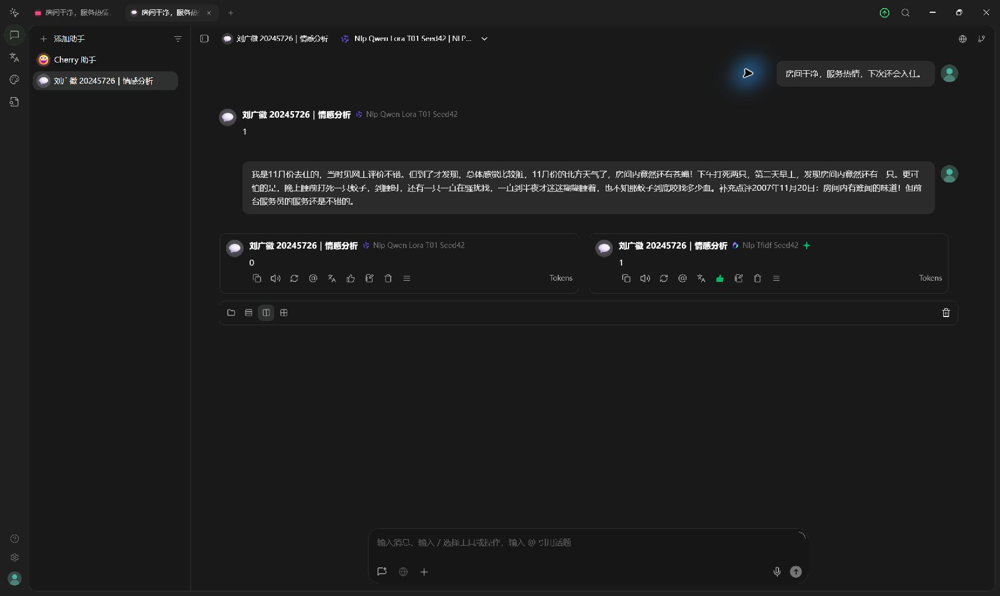

# Cherry Studio原生界面验收

日期：2026-10-29。正式录屏采用Cherry普通“对话”，网页保留作备用。

已完成：

- 新增“NLP课程实验｜本地五方案”服务，地址`http://127.0.0.1:8017/v1`；五个模型均已同步。
- 新建普通助手“刘广徽 20245726｜情感分析”，绑定LoRA T01种子42，系统提示留空，无知识库或工具。
- 从Cherry发送普通正面评论，LoRA原始返回`1`。
- 从Cherry发送6353号完整评论，LoRA原始返回`0`；使用“切换模型回答”调用TF-IDF，原始返回`1`，同题分栏可见。
- 姓名学号、模型名、评论及实际回复在原生窗口可核查；后台记录相同实际评论、严格解析结果、耗时、冻结权重SHA256和忽略历史条数。

| 请求 | 模型 | 原始输出 |
|---|---|---|
| `demo-3f08e8e4de2847038d810e7cab502c2e` | LoRA，普通样例 | 1 |
| `demo-1dc64b37bbb943cab158c1498cf8023c` | LoRA，6353号 | 0 |
| `demo-6976e7e5985d4616a0dc6d1ef9f0cbbf` | TF-IDF，6353号 | 1 |

原始记录见[requests.jsonl](requests.jsonl)，状态及校验见[status.json](status.json)。这里是三条真实客户端调用，不是新增全测试集成绩。没有训练、改标签或更换种子，也不表示新机复现或最终录屏已经完成。

初次启动工具等待应用授权超时的记录保留；后续取得窗口后已成功配置并验收。`previous-materials/`保存更新前讲稿和说明，当前使用[新版演示材料](../../../docs/demo/README.md)。最终仍由本人录制≤2分钟、有声音的MP4，并回看确认要求。
